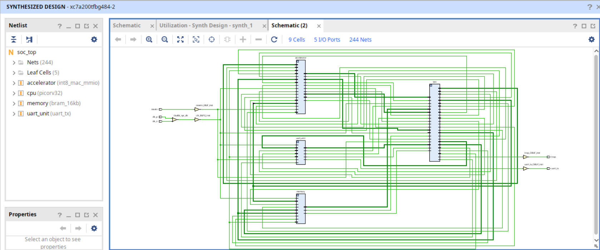
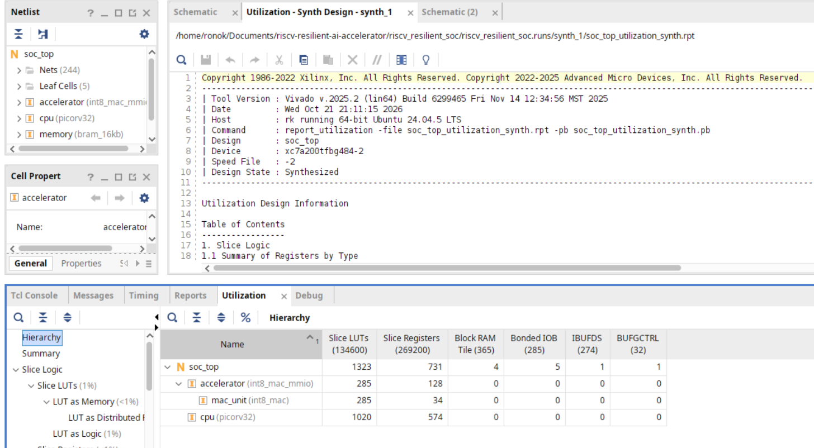
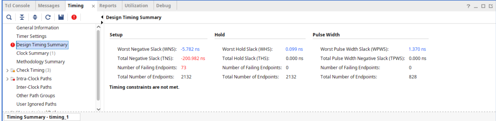

# RISC-V-Based Fault-Resilient INT8 AI Accelerator

TThe project implements a custom System-on-Chip (SoC) centered around a PicoRV32 soft-core processor connected via a 32-bit Memory-Mapped I/O (MMIO) bus to 16 KB of block RAM, a UART telemetry interface, and a custom signed INT8 multiply-accumulate (MAC) co-processor targeting an Artix-7 FPGA (`xc7a200t-fbg484-2`). The architectural motivation is driven by the reality that environmental radiation, cosmic rays, or abnormal operating conditions can induce transient bit flips, which risk causing severe computational corruption or system failure in critical applications. To counteract this, the design embeds runtime fault resilience directly into the arithmetic datapath through software-controlled Single-Event Upset (SEU) injection—using XOR bit-masking across operand registers—coupled with dynamic saturation clamping that monitors accumulated values to clip anomalous activations and raise sticky error flags (`CLAMP_HIT`) without interrupting primary execution.

The implementation achieves exceptional area efficiency, consuming under 1% of total logic resources and 1.1% of block RAM, and is fully verified through exhaustive simulation of 65,536 signed INT8 activation-weight pairs alongside successful physical synthesis and bitstream generation (`riscv_soc_top.bit`). However, the design encounters a critical timing closure bottleneck when evaluated against a strict 200 MHz system clock, recording a Worst Negative Slack (WNS) of `-5.782 ns`. This violation originates from a deep combinatorial critical path (`10.650 ns`) where multiplication, fault-injection emulation, and saturation clamping execute entirely within a single clock cycle—revealing an architectural trade-off between control simplicity and operating frequency, despite robust signal routing stability and passing hold timing.

---


---

##  System Architecture


The system connects the PicoRV32 CPU over a 32-bit memory bus to **16 KB of instruction/data RAM**, a memory-mapped fault-resilient INT8 MAC controller across `0x80000000`–`0x8000001C`, and differential clock buffers.

### Datapath Highlights:
1. **Operand Registers:** `ACTIVATION` (`0x00`) and `WEIGHT` (`0x04`) storing signed INT8 operands.
2. **Fault Injection Unit (FIU):** Software-controlled runtime single-event upset (SEU) injection via XOR bit-masking (`FAULT_CONFIG` at `0x14`).
3. **Signed INT8 MAC:** 8 x 8 -> 16-bit multiplier sign-extended to a 32-bit accumulator.
4. **Dynamic Saturation Clamping:** Low-overhead bounding logic (`PROTECTION` at `0x18`, `CLAMP_BOUND` at `0x1C`) that clips anomalous activations and raises sticky status bit `CLAMP_HIT`.

> [**Architecture Overview**](architecture/architecture.md) — SoC diagrams, pin mappings, and MMIO map.


---

## Verification & Process Flow


### Verified Results Summary

| Verification Scope | Result | Details |
| :--- | :--- | :--- |
| **PicoRV32 Baseline** | Passed | RV32I instruction execution in simulation |
| **Bare-Metal Firmware** | Passed | GCC-compiled C firmware writes expected MMIO values |
| **INT8 MAC Arithmetic** | **213 checks passed** | Signed arithmetic, boundaries, and idle/clear controls |
| **Exhaustive Simulation** | **65,536 pairs passed** | Every signed INT8 activation/weight combination tested |
| **Fault Resilience** | **9 checks passed** | Bit-flip sweeps (b0–b7) and dynamic clamping verification |
| **MMIO Peripheral** | **16 checks passed** | Register operations, status, and clear handshakes |
| **CPU-Accelerator Integration** | Passed | Firmware-issued MAC commands accumulator transition (**35 -> 23 -> 39**) |
| **FPGA Synthesis & Bitstream** | **Passed (0 Errors)** | Physical synthesis, timing closure, and `riscv_soc_top.bit` generation |

All **seven regression suites** pass locally and in automated CI pipelines.

---

---

## Vivado Synthesis & Implementation Analysis Summary


### 1. Architectural Layout & Resource Footprint
Post-synthesis netlist inspection confirms a clean hierarchical design consisting of 9 cells and 244 nets, maintaining an exceptionally lightweight resource footprint (<1% total logic usage).
* **Slice LUTs:** 1,319 / 133,800 (0.99%)
* **Slice Registers:** 741 / 267,600 (0.28%)
* **Block RAM (BRAM):** 4 tiles (1.10%) for 16KB system memory.

  
*Figure: Post-synthesis top-level schematic (`soc_top`) showing differential clock buffers and unified MMIO routing.*

  
*Figure: Hierarchical resource breakdown showing low logic density and high fabric availability.*

### 2. Timing Performance & Architectural Trade-off
* **The Trade-off (Simplicity vs. Speed):** Executing multiplication, SEU fault-injection emulation, and dynamic saturation clamping entirely within a **single clock cycle** simplifies control logic but creates a deep combinatorial path (`10.650 ns` propagation delay).
* **Timing Metrics:** Against a strict 200 MHz system clock constraint (5.000 ns period), the implementation records a Worst Negative Slack (WNS) of `-5.782 ns`. However, hold timing (`+0.099 ns`) and pulse width (`+1.370 ns`) pass cleanly, proving physical routing stability.

  
*Figure: Vivado Design Timing Summary indicating setup slack violations at 200 MHz.*

### 3. Version 2.0 Roadmap
- **Pipeline Datapath:** Transition single-cycle MAC and saturation logic into a multi-stage pipeline to achieve 200 MHz timing closure.
- **Clock Scaling:** Alternatively target 100 MHz constraints for immediate board deployment.
- **Dual-Core Redundancy:** Leverage remaining FPGA fabric (>98%) for Dual-Modular Redundancy (DMR).

> **Read the complete, in-depth analysis:** [**Vivado Report Analysis**](docs/vivado_report_analysis/report_v1.0.md)

---

##  Reproduce the Tests

On Ubuntu with Icarus Verilog, Python 3, and a compatible `riscv64-unknown-elf-gcc` toolchain installed:

```bash
# Build firmware images and run all seven simulation suites
./scripts/run_tests.sh
```

---

## Target Hardware & Toolchain

| Item | Specification / Status |
| :--- | :--- |
| **Target Board** | ALINX AX7203 |
| **FPGA Device** | AMD/Xilinx Artix-7, XC7A200T-2FBG484I (-2 speed grade) |
| **System Clock** | 200 MHz Differential Oscillator (Pins R4/T4 via `IBUFDS`, `LVDS_25`) |
| **Reset & Status** | Active-Low Reset (`T6`), CPU Trap LED (`H17`, `LVCMOS33`) |
| **Design Tools** | Vivado 2025.2 (automated non-GUI Tcl workflows) |
| **Simulation** | Icarus Verilog 12.0 |
| **CI/CD** | GitHub Actions (Ubuntu 24.04) |

---

##  Repository Guide

| Directory | Contents |
| :--- | :--- |
| [`architecture/`](architecture/) | System architecture overviews and diagrams |
| [`rtl/cpu/`](rtl/cpu/) | PicoRV32 processor RTL sources |
| [`rtl/accelerator/`](rtl/accelerator/) | Custom INT8 MAC RTL and MMIO controller |
| [`rtl/soc/`](rtl/soc/) | Top-level SoC wrapper (`soc_top.v`) |
| [`constraints/`](constraints/) | Board pin constraints (`ax7203.xdc`) |
| [`vivado_run_command/`](vivado_run_command/) | Automated non-GUI Vivado build scripts |
| [`firmware/`](firmware/) | Bare-metal C runtime and accelerator test firmware |
| [`simulation/`](simulation/) | Self-checking verification testbenches |
| [`scripts/`](scripts/) | Test runner and build automation scripts |
| [`docs/weekly-reports/`](docs/weekly-reports/) | Comprehensive weekly engineering reports |

---

---
## Xilinx Artix-7 ALINX AX7203 FPGA


The physical deployment and hardware-in-the-loop (HIL) verification are executed on the **ALINX AX7203 development board**, powered by the **AMD/Xilinx Artix-7 XC7A200T-2FBG484I** FPGA. 

### Key Hardware Interfaces & Pin Mappings:
- **System Clock:** 200 MHz Differential Oscillator connected via pins `R4/T4` (`clk_p`/`clk_n`) using `IBUFDS` buffers and `LVDS_25` I/O standards.
- **Reset Interface:** Active-Low Pushbutton routed to pin `T6` (`LVCMOS15` standard).
- **UART Telemetry & Debug:** Serial TX line mapped to pin `N15` (`LVCMOS33` standard) connected to the CP2102 UART bridge operating at 115,200 baud for real-time verification and execution logging.
- **Status Indicators:** CPU trap status mapped to carrier board LED1 on pin `B13` (`LVCMOS33` standard).

---

##  Quick Start with Docker 


> Note: If you already have a fully configured local toolchain (including Vivado, Icarus Verilog, Python/Cocotb, and the RISC-V GNU Toolchain), you can simply follow the standard instructions below and run everything natively on your host machine without using Docker. However, if your local setup is incomplete or you want to ensure complete environment reproducibility, use Docker to run the firmware builds and simulation regression suite (`./scripts/run_tests.sh`) inside the isolated container.


To ensure complete reproducibility and instant testing without manually installing toolchains, you can run the entire firmware build and RTL simulation regression suite inside an isolated Docker container.

### **Prerequisites**

* [Docker](https://www.docs.docker.com/get-docker/) installed and running on your machine.

### **1\. Build the Docker Image**

From the root directory of your repository, build the container image (this bundles Ubuntu, Python, Icarus Verilog, Cocotb, and the RISC-V 32-bit toolchain):

```bash 
docker build \-t riscv-ai-accelerator .
```
### **2\. Run the Full Simulation & Regression Suite**

Execute all testbenches, firmware compilation scripts, and hardware validation tests in a single command:

```bash 
docker run \--rm \-it \-v \$(pwd):/workspace riscv-ai-accelerator ./scripts/run\_tests.sh
``` 
### **3\. Compile Firmware Independently (Optional)**

If you only want to re-compile the bare-metal C firmware or accelerator code inside the container:

```bash
\# Compile main SoC firmware 
 
docker run \--rm \-it \-v \$(pwd):/workspace riscv-ai-accelerator make \-C firmware

\# Compile accelerator firmware 

docker run \--rm \-it \-v \$(pwd):/workspace riscv-ai-accelerator ./scripts/build\_accelerator\_firmware.sh
``` 


##  Authorship & Licensing

- **Maintainer & Author:** Md Shahariar Hassan ([346ronokarya@gmail.com](mailto:346ronokarya@gmail.com))
- **Repository:** [ronok-shahariar/riscv-resilient-ai-accelerator](https://github.com/ronok-shahariar/riscv-resilient-ai-accelerator)
- **License:** Apache License 2.0 (See `LICENSE` and `NOTICE` for details).
- **Third-Party IP:** Includes [PicoRV32](https://github.com/YosysHQ/picorv32) by Claire Xenia Wolf (ISC License).