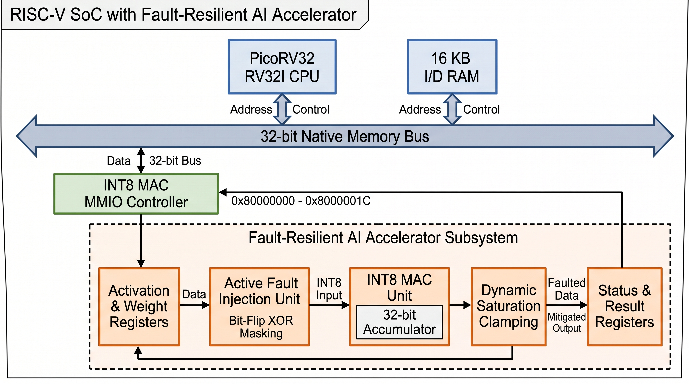

# RISC-V-Based Fault-Resilient INT8 AI Accelerator

A research-oriented FPGA project integrating a **PicoRV32 RISC-V processor** with a custom **signed INT8 multiply-accumulate (MAC) accelerator** through memory-mapped I/O (MMIO). Development proceeds incrementally from processor and firmware verification to accelerator integration, fault-resilience experiments, and FPGA implementation.

> **Current stage — Weeks 1–3 completed:** Processor-controlled INT8 MAC execution, transient fault injection, and dynamic saturation clamping resilience have been verified **in RTL simulation** and through automated regression tests. Physical FPGA synthesis, timing closure, and on-board deployment on the Artix-7 target are scheduled for Week 4.

## Start Here

- **[Architecture overview](architecture/architecture.md)** — SoC and verification diagrams, design decisions, and development roadmap.
- **[Week 1 engineering report](docs/weekly-reports/Week_01_RISCV_FPGA_Engineering_Report.md)** — PicoRV32 baseline, RV32I firmware execution, toolchain validation, and initial CI.
- **[Week 2 engineering report](docs/weekly-reports/Week_02_RISCV_INT8_Accelerator_Engineering_Report.md)** — INT8 MAC design, arithmetic and MMIO tests, CPU-controlled integration, debugging, and CI evidence.
- **[Week 3 engineering report](docs/weekly-reports/Week_03_Fault_Resilience_Engineering_Report.md)** — Fault model, bit-level vulnerability sweeps, dynamic saturation clamping, and 7-suite regression.

## System Architecture



The system connects the PicoRV32 RV32I CPU over a 32-bit native memory bus to **16 KB of instruction/data RAM**, a memory-mapped fault-resilient INT8 MAC controller across `0x80000000`–`0x8000001C`, and a simulation-only result reporting address at `0x10000000`.

The accelerator datapath integrates:
1. **Operand Registers:** `ACTIVATION` (`0x00`) and `WEIGHT` (`0x04`) storing signed INT8 operands.
2. **Fault Injection Unit (FIU):** Software-controlled runtime single-event upset (SEU) injection via XOR bit-masking (`FAULT_CONFIG` at `0x14`).
3. **Signed INT8 MAC:** 8 x 8 -> 16-bit multiplier sign-extended to a 32-bit accumulator.
4. **Dynamic Saturation Clamping:** Low-overhead inline bounding logic (`PROTECTION` at `0x18`, `CLAMP_BOUND` at `0x1C`) that clips anomalous activations to [-BOUND, +BOUND] and raises sticky status bit `CLAMP_HIT`.

For register addresses and additional design details, see the [architecture overview](architecture/architecture.md).

## Verified Results

| Verification | Result | Scope |
|---|---|---|
| PicoRV32 baseline | Passed | RV32I instruction execution in simulation |
| PicoRV32 bare-metal firmware | Passed | GCC-compiled C firmware writes the expected MMIO value |
| INT8 MAC directed/randomized tests | **213 checks passed** | Signed arithmetic, boundaries, idle/clear controls, wraparound |
| INT8 MAC exhaustive test | **65,536 operand pairs passed** | Every signed INT8 activation/weight combination in the tested accumulation sequence |
| INT8 MAC fault resilience | **9 checks passed** | Bit-flip sweeps (b0–b7), MSB vulnerability, and dynamic saturation clamping |
| INT8 MAC MMIO peripheral | **16 checks passed** | Register operations, status, clear, and held-request behavior |
| PicoRV32 + INT8 MAC integration | Passed | Three firmware-issued MAC commands; accumulator **35 -> 23 -> 39** |

All **seven regression suites** passed locally and in automated simulation workflows. These results establish correctness of the **tested RTL simulation scenarios**; they are not FPGA throughput, power, timing-closure, or fault-tolerance measurements on physical silicon.


## Reproduce the Tests

On Ubuntu with Icarus Verilog, Python 3, a compatible `riscv64-unknown-elf-gcc` cross-compiler, and RISC-V binutils installed:

```bash
# Build both firmware images and run all seven RTL/firmware simulation suites
./scripts/run_tests.sh
```

The runner builds both the baseline and accelerator firmware, invokes Icarus Verilog (`iverilog`/`vvp`), and writes simulation logs under `simulation/build/`. The same command is executed by [GitHub Actions](.github/workflows/rtl-ci.yml) on Ubuntu 24.04.

## Target Platform and Tools

| Item | Selection / status |
|---|---|
| Target board | ALINX AX7203 — FPGA deployment planned |
| FPGA family | AMD/Xilinx Artix-7, XC7A200T family |
| Exact FPGA package and speed grade | **Not yet confirmed** |
| FPGA design tools | Vivado 2025.2, installation/device-family support checked |
| CPU | PicoRV32 (RV32I configuration) |
| Firmware | Freestanding C and RISC-V assembly, GNU cross-toolchain |
| Simulation | Icarus Verilog 12.0 (local baseline) |
| CI | GitHub Actions, Ubuntu 24.04 |

## Weekly Development Roadmap

| Week | Focus | Status | Documentation |
|---|---|---|---|
| **1** | PicoRV32 baseline, RV32I firmware, simulation, CI setup | **Completed** | [Week 1 report](docs/weekly-reports/Week_01_RISCV_FPGA_Engineering_Report.md) |
| **2** | Signed INT8 MAC, exhaustive verification, MMIO controller, CPU integration | **Completed** | [Week 2 report](docs/weekly-reports/Week_02_RISCV_INT8_Accelerator_Engineering_Report.md) |
| **3** | Fault model, transient injection, detection/mitigation experiments | **Completed** | [Week 3 report](docs/weekly-reports/Week_03_Fault_Resilience_Engineering_Report.md) |
| **4** | Synthesizable SoC integration, Vivado synthesis and timing/resource analysis; hardware evaluation if feasible | Planned | Report pending |

## Research Objectives

1. Integrate a RISC-V CPU with an INT8 accelerator.
2. Compare software and hardware execution cycles under a clearly defined benchmark.
3. Investigate transient bit-flip fault effects.
4. Evaluate low-overhead fault-detection and mitigation techniques.
5. Measure FPGA resource utilization and timing after synthesis and implementation.

## Repository Guide

| Location | Contents |
|---|---|
| [`architecture/`](architecture/) | High-level architecture overview and compact diagrams |
| [`rtl/cpu/`](rtl/cpu/) | Third-party PicoRV32 RTL and attribution/license files |
| [`rtl/accelerator/`](rtl/accelerator/) | Project-specific INT8 MAC RTL and MMIO controller |
| [`firmware/src/`](firmware/src/) | Baseline bare-metal firmware and startup code |
| [`firmware/accelerator/`](firmware/accelerator/) | CPU-controlled accelerator firmware |
| [`simulation/testbench/`](simulation/testbench/) | Self-checking verification testbenches |
| [`scripts/`](scripts/) | Firmware build scripts and test runner |
| [`docs/weekly-reports/`](docs/weekly-reports/) | Detailed weekly engineering reports |
| [`screenshots/`](screenshots/) | Captured verification evidence |
| [`.github/workflows/`](.github/workflows/) | CI workflow |

## Limitations and Next Steps

The completed work provides a **simulation-verified fault-resilient baseline**, not yet a deployed physical FPGA design. In particular, there are no measured Artix-7 resource counts, timing-closure results, on-board throughput figures, or physical fault-tolerance measurements. The SoC testbench's RAM and address routing must also be migrated into synthesizable hardware before FPGA implementation.

Week 4 targets synthesizable SoC integration, Block RAM inference, and Vivado synthesis/implementation on the ALINX AX7203 target.

## Authorship, Licensing, and Research Citation

**Project maintainer and original accelerator author:** Md Shahariar Hassan

**Research contact:** 346ronokarya@gmail.com

**Original repository:** [ronok-shahariar/riscv-resilient-ai-accelerator](https://github.com/ronok-shahariar/riscv-resilient-ai-accelerator)

### Original Project Contributions

The project-specific contributions include:

- Design and RTL implementation of the signed INT8 MAC accelerator with runtime fault injection and dynamic saturation clamping.
- Development of the MMIO peripheral and its control interface.
- PicoRV32-controlled accelerator integration and bare-metal C firmware.
- Directed, randomized, exhaustive, fault-resilience, MMIO, and end-to-end verification.
- Firmware build automation, GitHub Actions CI, and engineering documentation.

These contributions are distinct from the third-party PicoRV32 processor and other external tools.

### Third-Party Attribution

This repository includes [PicoRV32](https://github.com/YosysHQ/picorv32), an open-source RISC-V processor developed by **Claire Xenia Wolf**.

PicoRV32 remains under its original **ISC License**. The original copyright and license text are preserved in [`rtl/cpu/PICORV32_LICENSE`](rtl/cpu/PICORV32_LICENSE).

The project maintainer does not claim authorship of PicoRV32.

### License and Reuse

Original project contributions are available under the **[Apache License 2.0](LICENSE)**, to the extent that the maintainer owns the applicable rights.

Researchers and developers may use, modify, experiment with, and redistribute the licensed work, including for commercial purposes, subject to the applicable license terms.

The Apache 2.0 license does not override PicoRV32's separate ISC license.

See [`NOTICE`](NOTICE) for copyright attribution and project provenance.

### Academic Citation

If this project supports your research, please cite the original repository:

> Md Shahariar Hassan. *RISC-V-Based Fault-Resilient INT8 AI Accelerator*. GitHub repository: https://github.com/ronok-shahariar/riscv-resilient-ai-accelerator

GitHub's **Cite this repository** feature uses [`CITATION.cff`](CITATION.cff).

Academic citation is requested as a scholarly courtesy, not as an additional Apache 2.0 licensing requirement. The project's Git history, source headers, and engineering reports provide a record of its development but are not independent proof of legal ownership or research novelty.