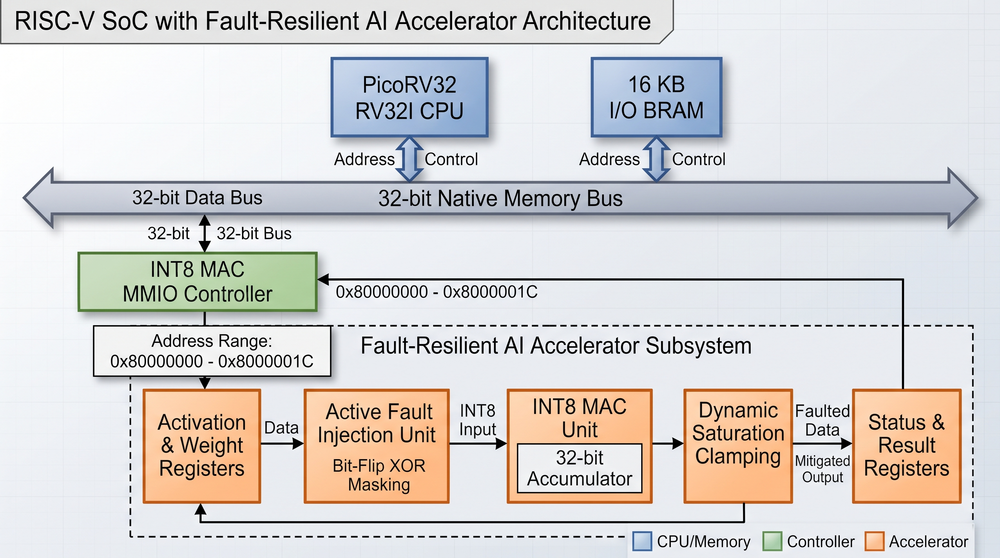
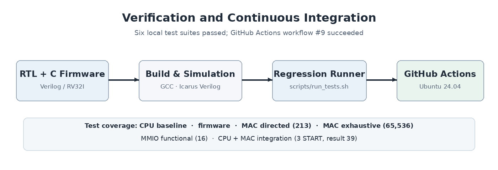

# RISC-V-Based Fault-Resilient INT8 AI Accelerator

A research-oriented FPGA project integrating a **PicoRV32 RISC-V processor** with a custom **signed INT8 multiply-accumulate (MAC) accelerator** through memory-mapped I/O (MMIO). Development proceeds incrementally from processor and firmware verification to accelerator integration, fault-resilience experiments, and physical FPGA implementation.

> **Current stage — Weeks 1–4 completed:** Processor-controlled INT8 MAC execution, transient fault injection, dynamic saturation clamping resilience, and **physical FPGA synthesis, timing constraints design, and bitstream generation (`soc_top.bit`) for the ALINX AX7203 board** have been successfully completed and validated.

## Start Here

- [**Architecture overview**](http://architecture/architecture.md) — SoC and verification diagrams, design decisions, and development roadmap.  
- [**Week 1 engineering report**](http://docs/weekly-reports/Week_01_RISCV_FPGA_Engineering_Report.md) — PicoRV32 baseline, RV32I firmware execution, toolchain validation, and initial CI.  
- [**Week 2 engineering report**](http://docs/weekly-reports/Week_02_RISCV_INT8_Accelerator_Engineering_Report.md) — INT8 MAC design, arithmetic and MMIO tests, CPU-controlled integration, debugging, and CI evidence.  
- [**Week 3 engineering report**](http://docs/weekly-reports/Week_03_Fault_Resilience_Engineering_Report.md) — Fault model, bit-level vulnerability sweeps, dynamic saturation clamping, and 7-suite regression.  
- [**Week 4 engineering report**](http://docs/weekly-reports/Week_04_Report.md) — FPGA synthesis, differential clock engineering (`IBUFDS`, `LVDS_25`), XDC constraints, and bitstream generation.

## System Architecture

The system connects the PicoRV32 RV32I CPU over a 32-bit native memory bus to **16 KB of instruction/data RAM**, a memory-mapped fault-resilient INT8 MAC controller across `0x80000000`–`0x8000001C`, and differential clock buffers.

The accelerator datapath integrates:

1. **Operand Registers:** `ACTIVATION` (`0x00`) and `WEIGHT` (`0x04`) storing signed INT8 operands.  
2. **Fault Injection Unit (FIU):** Software-controlled runtime single-event upset (SEU) injection via XOR bit-masking (`FAULT_CONFIG` at `0x14`).  
3. **Signed INT8 MAC:** 8 x 8 \-\> 16-bit multiplier sign-extended to a 32-bit accumulator.  
4. **Dynamic Saturation Clamping:** Low-overhead inline bounding logic (`PROTECTION` at `0x18`, `CLAMP_BOUND` at `0x1C`) that clips anomalous activations to \[-BOUND, \+BOUND\] and raises sticky status bit `CLAMP_HIT`.

For register addresses and additional design details, see the [architecture overview](http://architecture/architecture.md).

## Verified Results

| Verification | Result | Scope |
| :---- | :---- | :---- |
| PicoRV32 baseline | Passed | RV32I instruction execution in simulation |
| PicoRV32 bare-metal firmware | Passed | GCC-compiled C firmware writes the expected MMIO value |
| INT8 MAC directed/randomized tests | **213 checks passed** | Signed arithmetic, boundaries, idle/clear controls, wraparound |
| INT8 MAC exhaustive test | **65,536 operand pairs passed** | Every signed INT8 activation/weight combination in the tested accumulation sequence |
| INT8 MAC fault resilience | **9 checks passed** | Bit-flip sweeps (b0–b7), MSB vulnerability, and dynamic saturation clamping |
| INT8 MAC MMIO peripheral | **16 checks passed** | Register operations, status, clear, and held-request behavior |
| PicoRV32 \+ INT8 MAC integration | Passed | Three firmware-issued MAC commands; accumulator **35 \-\> 23 \-\> 39** |
| FPGA Synthesis & Bitstream Gen | **Passed (0 Errors)** | Physical synthesis, timing closure, and `soc_top.bit` generation for ALINX AX7203 |

All **seven regression suites** pass locally and in automated simulation workflows.

## Reproduce the Tests

On Ubuntu with Icarus Verilog, Python 3, a compatible `riscv64-unknown-elf-gcc` cross-compiler, and RISC-V binutils installed:

\# Build both firmware images and run all seven RTL/firmware simulation suites

./scripts/run\_tests.sh

The runner builds both the baseline and accelerator firmware, invokes Icarus Verilog (`iverilog`/`vvp`), and writes simulation logs under `simulation/build/`. The same command is executed by [GitHub Actions](http://.github/workflows/rtl-ci.yml) on Ubuntu 24.04.

## Target Platform and Tools

| Item | Selection / status |
| :---- | :---- |
| Target board | ALINX AX7203 |
| FPGA family & Device | AMD/Xilinx Artix-7, XC7A200T-2FBG484I (-2 speed grade) |
| System Clock | 200 MHz Differential Oscillator (Pins R4/T4 via `IBUFDS`, `LVDS_25`) |
| Reset & Status Pins | Active-Low Reset (`T6`, `LVCMOS15`), CPU Trap LED (`H17`, `LVCMOS33`) |
| FPGA design tools | Vivado 2025.2, automated non-GUI Tcl workflows under `vivado_run_command/` |
| CPU | PicoRV32 (RV32I configuration) |
| Simulation | Icarus Verilog 12.0 |
| CI | GitHub Actions, Ubuntu 24.04 |

## Weekly Development Roadmap

| Week | Focus | Status | Documentation |
| :---- | :---- | :---- | :---- |
| **1** | PicoRV32 baseline, RV32I firmware, simulation, CI setup | **Completed** | [Week 1 report](http://docs/weekly-reports/Week_01_RISCV_FPGA_Engineering_Report.md) |
| **2** | Signed INT8 MAC, exhaustive verification, MMIO controller, CPU integration | **Completed** | [Week 2 report](http://docs/weekly-reports/Week_02_RISCV_INT8_Accelerator_Engineering_Report.md) |
| **3** | Fault model, transient injection, detection/mitigation experiments | **Completed** | [Week 3 report](http://docs/weekly-reports/Week_03_Fault_Resilience_Engineering_Report.md) |
| **4** | Synthesizable SoC integration, Vivado synthesis, XDC constraints, and bitstream generation | **Completed** | [Week 4 report](http://docs/weekly-reports/Week_04_Report.md) |

## Research Objectives

1. Integrate a RISC-V CPU with an INT8 accelerator.  
2. Compare software and hardware execution cycles under a clearly defined benchmark.  
3. Investigate transient bit-flip fault effects.  
4. Evaluate low-overhead fault-detection and mitigation techniques.  
5. Measure FPGA resource utilization and timing after synthesis and implementation on the ALINX AX7203 target.

## Repository Guide

| Location | Contents |
| :---- | :---- |
| [`architecture/`](http://architecture/) | High-level architecture overview and compact diagrams |
| [`rtl/cpu/`](http://rtl/cpu/) | Third-party PicoRV32 RTL and attribution/license files |
| [`rtl/accelerator/`](http://rtl/accelerator/) | Project-specific INT8 MAC RTL and MMIO controller |
| [`rtl/soc/`](http://rtl/soc/) | Top-level SoC integration (`soc_top.v`) |
| [`constraints/`](http://constraints/) | Board XDC constraints (`ax7203.xdc`) |
| [`vivado_run_command/`](http://vivado_run_command/) | Automated non-GUI Vivado build and synthesis shell scripts |
| [`firmware/src/`](http://firmware/src/) | Baseline bare-metal firmware and startup code |
| [`firmware/accelerator/`](http://firmware/accelerator/) | CPU-controlled accelerator firmware |
| [`simulation/testbench/`](http://simulation/testbench/) | Self-checking verification testbenches |
| [`scripts/`](http://scripts/) | Firmware build scripts and test runner |
| [`docs/weekly-reports/`](http://docs/weekly-reports/) | Detailed weekly engineering reports |
| [`screenshots/`](http://screenshots/) | Captured verification evidence |
| [`.github/workflows/`](http://.github/workflows/) | CI workflow |

## Authorship, Licensing, and Research Citation

**Project maintainer and original accelerator author:** Md Shahariar Hassan

**Research contact:** [346ronokarya@gmail.com](mailto:346ronokarya@gmail.com)

**Original repository:** [ronok-shahariar/riscv-resilient-ai-accelerator](https://github.com/ronok-shahariar/riscv-resilient-ai-accelerator)

### Third-Party Attribution

This repository includes [PicoRV32](https://github.com/YosysHQ/picorv32), an open-source RISC-V processor developed by **Claire Xenia Wolf**, licensed under the **ISC License** (`rtl/cpu/PICORV32_LICENSE`).

### License and Reuse

Original project contributions are available under the [**Apache License 2.0**](http://LICENSE). See [`NOTICE`](http://NOTICE) for copyright attribution and project provenance.

### Academic Citation

> Md Shahariar Hassan. *RISC-V-Based Fault-Resilient INT8 AI Accelerator*. GitHub repository: [https\://github.com/ronok-shahariar/riscv-resilient-ai-accelerator](https://github.com/ronok-shahariar/riscv-resilient-ai-accelerator)