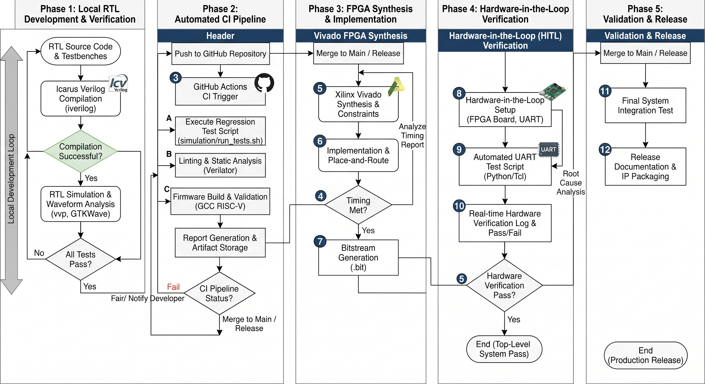
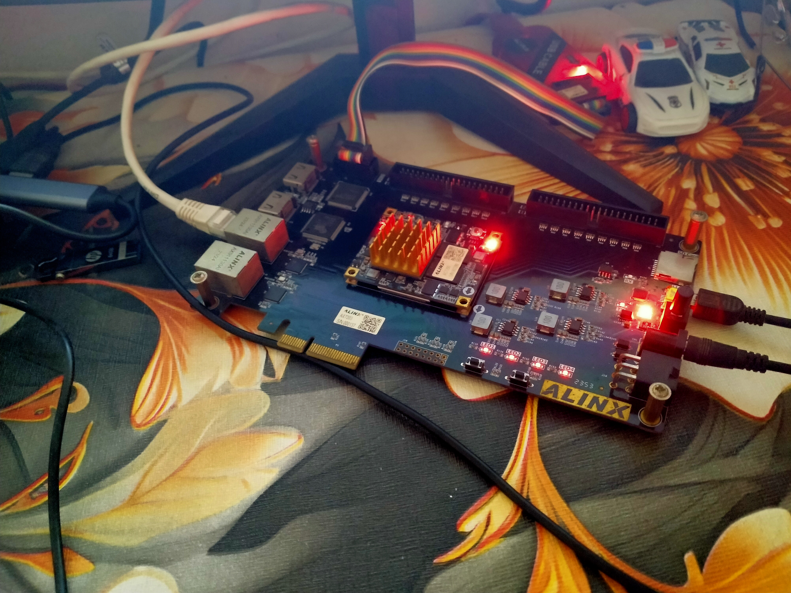

# RISC-V-Based Fault-Resilient INT8 AI Accelerator

A research-oriented FPGA project integrating a **PicoRV32 RISC-V processor** with a custom **signed INT8 multiply-accumulate (MAC) accelerator** via memory-mapped I/O (MMIO). 

> **Current status — Phase 1 Fully Completed (Weeks 1–4):** Processor-controlled INT8 MAC execution, transient fault injection, dynamic saturation clamping resilience, and **physical FPGA synthesis, timing closure, and bitstream generation (`riscv_soc_top.bit`) for the ALINX AX7203 board** have been successfully validated.

---

##  Quick Start & Documentation

- [**Architecture Overview**](architecture/architecture.md) — SoC diagrams, pin mappings, and MMIO map.
- [**Week 1 Report**](docs/weekly-reports/Week_01_RISCV_FPGA_Engineering_Report.md) — PicoRV32 baseline, RV32I firmware, and initial CI.
- [**Week 2 Report**](docs/weekly-reports/Week_02_RISCV_INT8_Accelerator_Engineering_Report.md) — INT8 MAC design, MMIO tests, and CPU integration.
- [**Week 3 Report**](docs/weekly-reports/Week_03_Fault_Resilience_Engineering_Report.md) — Fault modeling, SEU sweeps, and saturation clamping.
- [**Week 4 Report**](docs/weekly-reports/Week_04_Report.md) — FPGA synthesis, differential clocking (`IBUFDS`), and bitstream generation.

---

##  System Architecture


The system connects the PicoRV32 CPU over a 32-bit memory bus to **16 KB of instruction/data RAM**, a memory-mapped fault-resilient INT8 MAC controller across `0x80000000`–`0x8000001C`, and differential clock buffers.

### Datapath Highlights:
1. **Operand Registers:** `ACTIVATION` (`0x00`) and `WEIGHT` (`0x04`) storing signed INT8 operands.
2. **Fault Injection Unit (FIU):** Software-controlled runtime single-event upset (SEU) injection via XOR bit-masking (`FAULT_CONFIG` at `0x14`).
3. **Signed INT8 MAC:** 8 x 8 -> 16-bit multiplier sign-extended to a 32-bit accumulator.
4. **Dynamic Saturation Clamping:** Low-overhead bounding logic (`PROTECTION` at `0x18`, `CLAMP_BOUND` at `0x1C`) that clips anomalous activations and raises sticky status bit `CLAMP_HIT`.

---

## Verification & Process Flow



### Verified Results Summary

| Verification Scope | Result | Details |
| :--- | :--- | :--- |
| **PicoRV32 Baseline** | Passed | RV32I instruction execution in simulation |
| **Bare-Metal Firmware** | Passed | GCC-compiled C firmware writes expected MMIO values |
| **INT8 MAC Arithmetic** | **213 checks passed** | Signed arithmetic, boundaries, and idle/clear controls |
| **Exhaustive Simulation** | **65,536 pairs passed** | Every signed INT8 activation/weight combination tested |
| **Fault Resilience** | **9 checks passed** | Bit-flip sweeps (b0–b7) and dynamic clamping verification |
| **MMIO Peripheral** | **16 checks passed** | Register operations, status, and clear handshakes |
| **CPU-Accelerator Integration** | Passed | Firmware-issued MAC commands accumulator transition (**35 -> 23 -> 39**) |
| **FPGA Synthesis & Bitstream** | **Passed (0 Errors)** | Physical synthesis, timing closure, and `riscv_soc_top.bit` generation |

All **seven regression suites** pass locally and in automated CI pipelines.

---

##  Reproduce the Tests

On Ubuntu with Icarus Verilog, Python 3, and a compatible `riscv64-unknown-elf-gcc` toolchain installed:

```bash
# Build firmware images and run all seven simulation suites
./scripts/run_tests.sh
```

---

## Target Hardware & Toolchain

| Item | Specification / Status |
| :--- | :--- |
| **Target Board** | ALINX AX7203 |
| **FPGA Device** | AMD/Xilinx Artix-7, XC7A200T-2FBG484I (-2 speed grade) |
| **System Clock** | 200 MHz Differential Oscillator (Pins R4/T4 via `IBUFDS`, `LVDS_25`) |
| **Reset & Status** | Active-Low Reset (`T6`), CPU Trap LED (`H17`, `LVCMOS33`) |
| **Design Tools** | Vivado 2025.2 (automated non-GUI Tcl workflows) |
| **Simulation** | Icarus Verilog 12.0 |
| **CI/CD** | GitHub Actions (Ubuntu 24.04) |

---

##  Repository Guide

| Directory | Contents |
| :--- | :--- |
| [`architecture/`](architecture/) | System architecture overviews and diagrams |
| [`rtl/cpu/`](rtl/cpu/) | PicoRV32 processor RTL sources |
| [`rtl/accelerator/`](rtl/accelerator/) | Custom INT8 MAC RTL and MMIO controller |
| [`rtl/soc/`](rtl/soc/) | Top-level SoC wrapper (`soc_top.v`) |
| [`constraints/`](constraints/) | Board pin constraints (`ax7203.xdc`) |
| [`vivado_run_command/`](vivado_run_command/) | Automated non-GUI Vivado build scripts |
| [`firmware/`](firmware/) | Bare-metal C runtime and accelerator test firmware |
| [`simulation/`](simulation/) | Self-checking verification testbenches |
| [`scripts/`](scripts/) | Test runner and build automation scripts |
| [`docs/weekly-reports/`](docs/weekly-reports/) | Comprehensive weekly engineering reports |

---

---
## Xilinx Artix-7 ALINX AX7203 FPGA



The physical deployment and hardware-in-the-loop (HIL) verification are executed on the **ALINX AX7203 development board**, powered by the **AMD/Xilinx Artix-7 XC7A200T-2FBG484I** FPGA. 

### Key Hardware Interfaces & Pin Mappings:
- **System Clock:** 200 MHz Differential Oscillator connected via pins `R4/T4` using `IBUFDS` buffers and `LVDS_25` I/O standards.
- **Reset Interface:** Active-Low Pushbutton routed to pin `T6` (`LVCMOS15` standard).
- **UART Telemetry & Debug:** Serial TX line mapped to pin `B13` (`LVCMOS33` standard) operating at 115,200 baud for real-time verification and execution logging.
- **Status Indicators:** CPU trap and status LEDs mapped to board user LEDs (e.g., pin `H17`).

---

##  Authorship & Licensing

- **Maintainer & Author:** Md Shahariar Hassan ([346ronokarya@gmail.com](mailto:346ronokarya@gmail.com))
- **Repository:** [ronok-shahariar/riscv-resilient-ai-accelerator](https://github.com/ronok-shahariar/riscv-resilient-ai-accelerator)
- **License:** Apache License 2.0 (See `LICENSE` and `NOTICE` for details).
- **Third-Party IP:** Includes [PicoRV32](https://github.com/YosysHQ/picorv32) by Claire Xenia Wolf (ISC License).