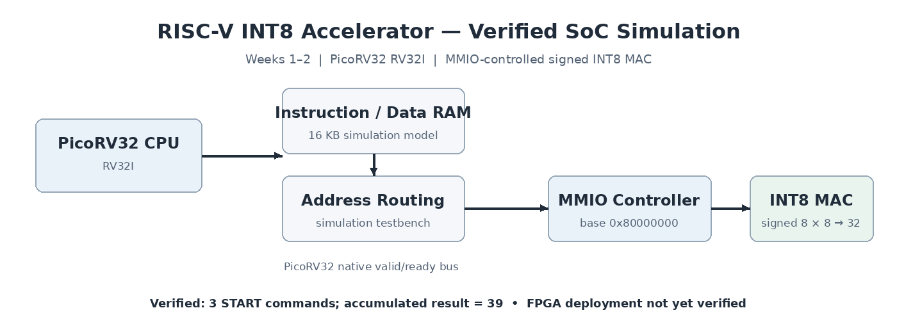

# RISC-V Fault-Resilient INT8 AI Accelerator — Architecture

**Current milestone:** Weeks 1–2 completed and verified in RTL simulation. **Next:** fault injection and mitigation (Week 3), followed by FPGA implementation evaluation (Week 4).

> **Scope:** The current SoC interconnect and 16 KB RAM live in the integration **simulation testbench**. FPGA synthesis, hardware timing, power, and fault-resilience measurements have **not** yet been demonstrated. Target board: ALINX AX7203 (Artix-7 family); exact device package/speed grade remains to be checked before board implementation.

## System at a glance



A PicoRV32 RV32I CPU runs compiled bare-metal C firmware from a 16 KB simulated instruction/data RAM. Its native memory interface routes accesses to RAM or the **INT8 MAC MMIO peripheral** (base `0x80000000`). The peripheral stores signed 8-bit operands, issues one-cycle **START/CLEAR** controls to the accelerator, and exposes a sticky DONE flag plus the signed 32-bit accumulated result. The testbench separately watches a simulation-only output address (`0x10000000`) to determine firmware PASS/FAIL.

The arithmetic datapath performs **signed INT8 × INT8**, sign-extends the 16-bit product, and accumulates into a 32-bit signed register with wraparound arithmetic (no saturation implemented). The original PicoRV32 and MAC implementations remain individually tested.

### MMIO register map

| Address | Register | Access | Function |
|---|---|---|---|
| `0x80000000` | ACTIVATION | Write | Signed INT8 in bits `[7:0]` |
| `0x80000004` | WEIGHT | Write | Signed INT8 in bits `[7:0]` |
| `0x80000008` | CONTROL | Write | Bit 0 START; bit 1 CLEAR (CLEAR wins) |
| `0x8000000C` | STATUS | Read | Bit 0 sticky DONE |
| `0x80000010` | RESULT | Read | Signed INT32 accumulator |
| `0x80000014`–`0x8000001F` | Reserved | — | Planned extension space; not implemented |

The current MMIO testbench checks register operations, signed accumulation, clearing, partial writes, and held-`mem_valid` behavior. The CPU integration test confirms the exercised firmware transaction sequence; it does not prove every possible bus traffic pattern.

## Verification and CI


Run the existing regression locally:

```bash
./scripts/run_tests.sh
```

The regression builds the baseline and accelerator-specific RV32I firmware and executes these six suites:

| Suite | Verified behavior |
|---|---|
| PicoRV32 baseline | Executes RV32I instructions and performs MMIO write |
| PicoRV32 firmware | Executes GCC-built C firmware |
| INT8 MAC directed/randomized | **213** self-checking checks including signed boundaries and wraparound |
| INT8 MAC exhaustive | **65,536** INT8 operand combinations |
| MMIO peripheral | **16** standalone register/control/handshake checks |
| PicoRV32 + MAC SoC | Firmware drives three MACs: **35 → 23 → 39** |

All six suites passed locally. GitHub Actions runs the same script on Ubuntu 24.04; **workflow #9** passed at report commit [`66c5266`](https://github.com/ronok-shahariar/riscv-resilient-ai-accelerator/commit/66c5266). The workflow's green status confirms CI execution; the regression logs provide the detailed individual test evidence.

## Weekly engineering roadmap

| Week | Focus | Status | Detailed report |
|---|---|---|---|
| **1** | PicoRV32 CPU baseline, RV32I firmware, simulation and CI | Completed | [Week 1 engineering report](../docs/weekly-reports/Week_01_RISCV_FPGA_Engineering_Report.md) |
| **2** | Signed INT8 MAC, exhaustive tests, MMIO controller, CPU integration and CI | Completed | [Week 2 engineering report](../docs/weekly-reports/Week_02_RISCV_INT8_Accelerator_Engineering_Report.md) |
| **3** | Fault model, transient injection, detection/mitigation experiments | Planned | Report to be added after verification |
| **4** | Vivado synthesis, resource/timing evaluation, potential board validation | Planned | Report to be added after measurement |

## Engineering contributions and traceability

- **Arithmetic RTL:** `rtl/accelerator/int8_mac.v` — signed multiplier and INT32 accumulator.
- **Memory-mapped peripheral:** `rtl/accelerator/int8_mac_mmio.v` — register interface, control pulses, completion status.
- **Bare-metal accelerator firmware:** `firmware/accelerator/main.c` — CPU-driven MAC operations and software checks.
- **SoC simulation:** `simulation/testbench/tb_picorv32_accelerator.v` — CPU, RAM, MMIO routing and end-to-end validation (not a synthesized top-level design).
- **Build and regression:** `scripts/build_accelerator_firmware.sh`, `scripts/run_tests.sh`, `.github/workflows/rtl-ci.yml`.
- **Evidence:** [`screenshots/week01`](../screenshots/week01/) and [`screenshots/week02`](../screenshots/week02/), with contextual explanations in the weekly reports.

**Not yet claimed:** FPGA resource utilization, achieved clock frequency, power, physical hardware operation, fault-detection coverage or improved inference accuracy. Those require the planned fault campaigns and hardware implementation work.
