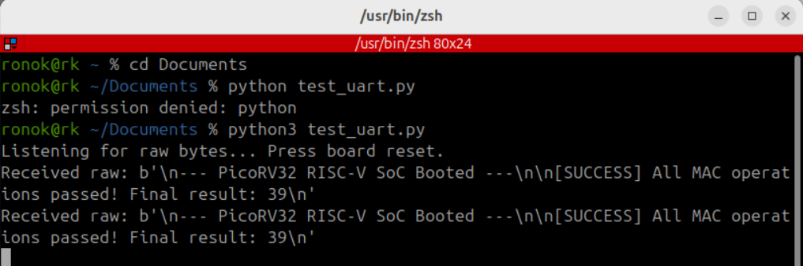
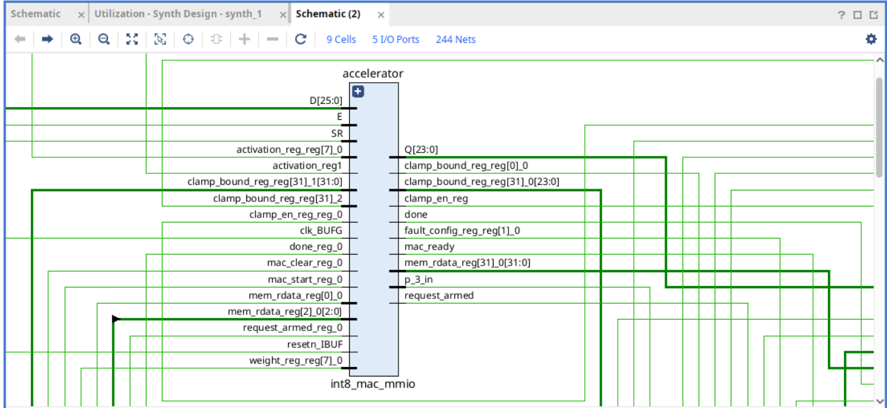

# **Engineering Report: RISC-V Resilient AI Accelerator SoC**

## **1\. Executive Summary & System Overview**

* **Target Hardware:** Xilinx Artix-7 FPGA (xc7a200t-fbg484-2).  
* **Architecture:** Integrates a PicoRV32 soft-core CPU, 16KB Block RAM instruction/data memory, a UART module, and a custom fault-tolerant INT8 MAC co-processor with dynamic saturation clamping and SEU fault-mitigation.

## **2\. Functional Simulation & Verification**

* **Verification:** Verified via open-source simulation tools (iverilog, GTKWave).  
* **Result:** Passed cleanly with expected validation output (Final result: 39).

**Figure 1:** Simulation log capturing successful execution confirmation (`Final result: 39`).

## **3\. Vivado Synthesis & Implementation Results**

### **3.1 Top-Level Architecture & Schematic Analysis**

* **Netlist:** Instantiates 9 top-level cells, 5 physical I/O ports, and 244 interconnect nets.  
* **Clock Routing:** Differential clock inputs (clk\_p, clk\_n) route through an IBUFDS buffer (ibufds\_sys\_clk) and global BUFG buffer to minimize skew.

**Figure 2:** Post-synthesis top-level schematic (`soc_top`).

### **3.2 Sub-Module Integration (int8\_mac\_mmio)**

* **MMIO Wrapper:** Bridges the PicoRV32 memory-mapped bus with control registers (mac\_start, mac\_clear), operand registers (activation, weight), and SEU fault-injection configuration lines.

**Figure 3:** Block view of the `int8_mac_mmio` accelerator wrapper.

### **3.3 Resource Utilization & Footprint Efficiency**

* **Specialty:** Exceptionally lightweight footprint consuming under 1% of total logic resources, leaving \>98% fabric headroom for expansion.

| Resource Type | Used | Available | Utilization (%) |
| :---- | :---- | :---- | :---- |
| **Slice LUTs (Logic)** | 1,319 | 133,800 | 0.99% |
| **Slice Registers (FFs)** | 741 | 267,600 | 0.28% |
| **Block RAM (BRAM)** | 4 (RAMB36E1) | 365 | 1.10% |
| **DSP Blocks** | 0 | 740 | 0.00% |
| **Bonded IOBs** | 5 | 285 | 1.75% |

**Figure 4:** Resource utilization summary.

## **4\. Critical Path & Timing Analysis (Trade-off Evaluation)**

### **4.1 Timing Violations**

* **Constraint:** 200 MHz system clock (5.000 ns period).  
* **Metrics:** Worst Negative Slack (WNS) of \-5.782 ns; Total Negative Slack (TNS) of \-200.982 ns across 73 failing endpoints. Robust hold timing (\+0.099 ns) and pulse width (\+1.370 ns).

**Figure 5:** Vivado Design Timing Summary.

### **4.2 Architectural Trade-off**

* **Simplicity vs. Speed:** Single-cycle execution of multiplication, SEU fault-injection, and dynamic saturation clamping simplifies control FSMs but creates a deep combinatorial critical path (10.650 ns delay) exceeding the 5.0 ns window.

## **5\. Synthesis Messages & Compiler Optimizations**

* **Operator Translation (\[Synth 8-589\]):** 4-state case equality (\===) mapped to 2-state boolean equality (\==) for physical binary LUTs.  
* **Logic Pruning (\[Synth 8-7071\]):** Unused PicoRV32 auxiliary interfaces stripped to optimize area.  
* **Bus Slicing (\[Synth 8-7129\]):** Unused upper address/data lines truncated for narrower peripherals.

## **6\. Conclusion & Version 2.0 Roadmap**

The design delivers a highly area-efficient (\<1% utilization) RISC-V SoC with integrated AI acceleration and fault resilience. **Version 2.0 Roadmap:**

1. **Pipeline Datapath:** Break single-cycle MAC/clamping logic into a 2-stage or 3-stage pipeline to meet the 5.0 ns threshold.  
2. **Clock Scaling:** Relax constraints to 100 MHz (10.0 ns) for immediate physical HIL deployment.  
3. **Dual-Core Redundancy:** Leverage remaining fabric (\>98%) for Dual-Modular Redundancy (DMR).  
   
