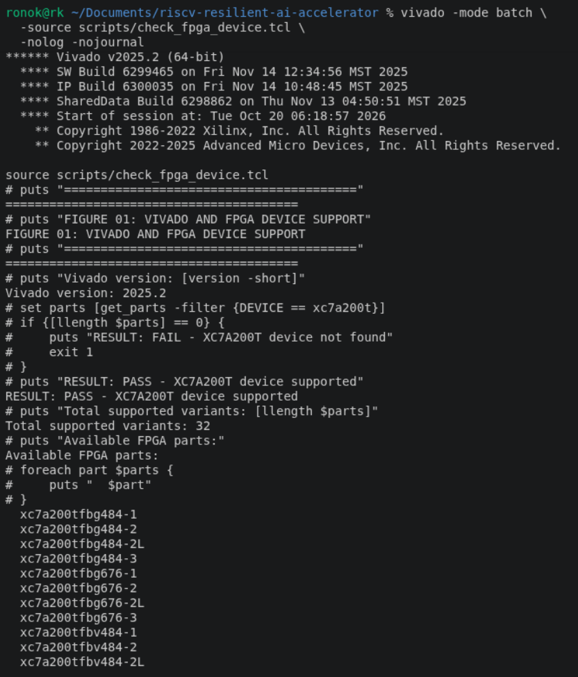
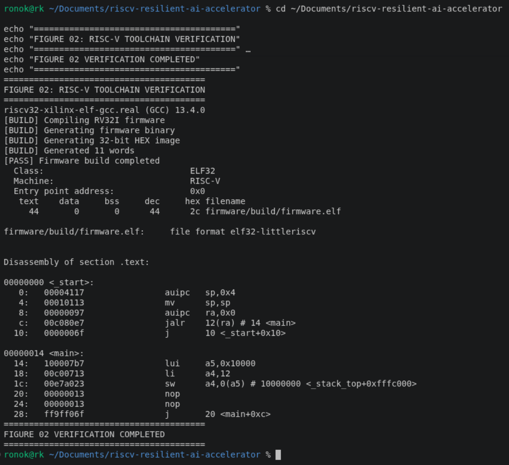
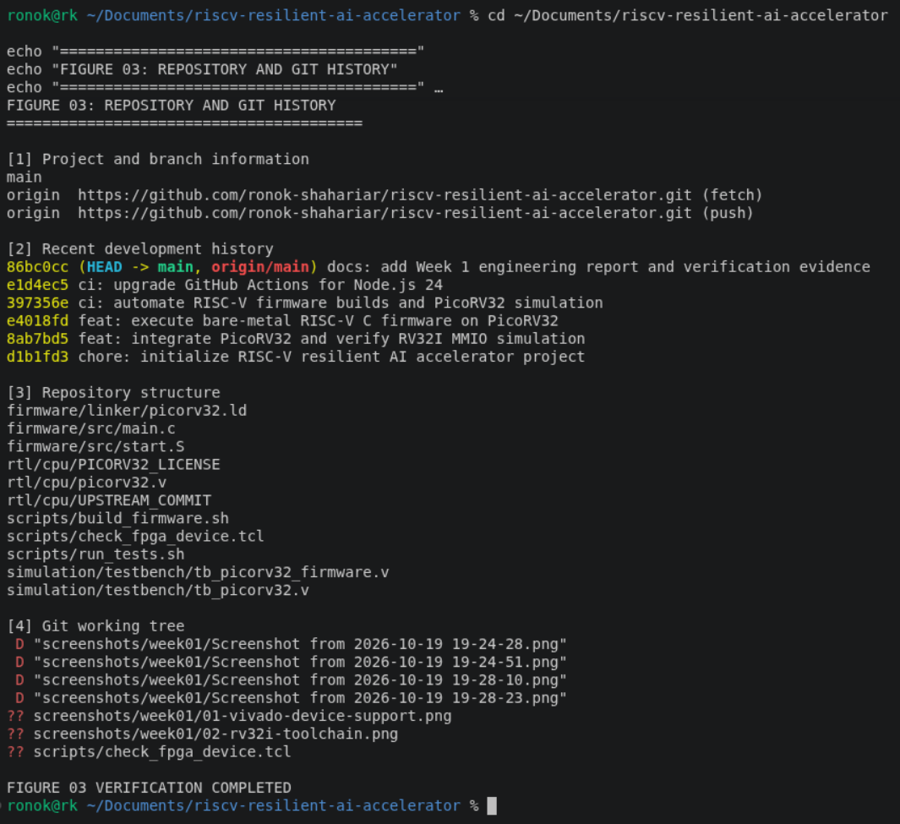
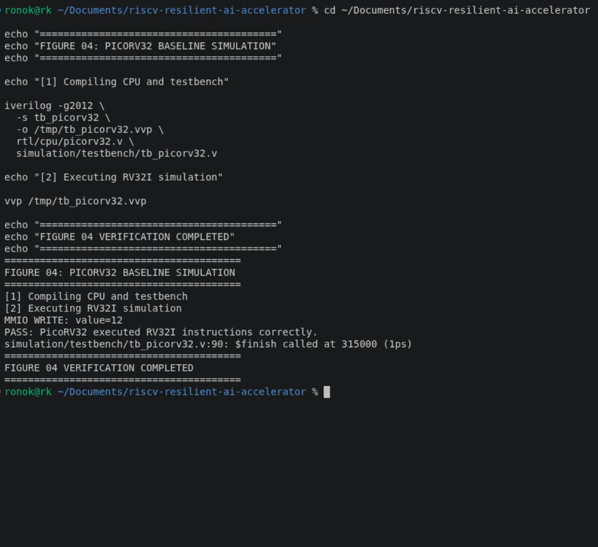
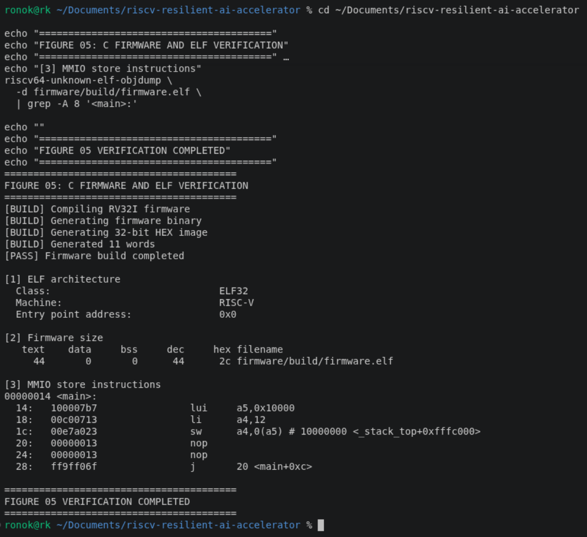
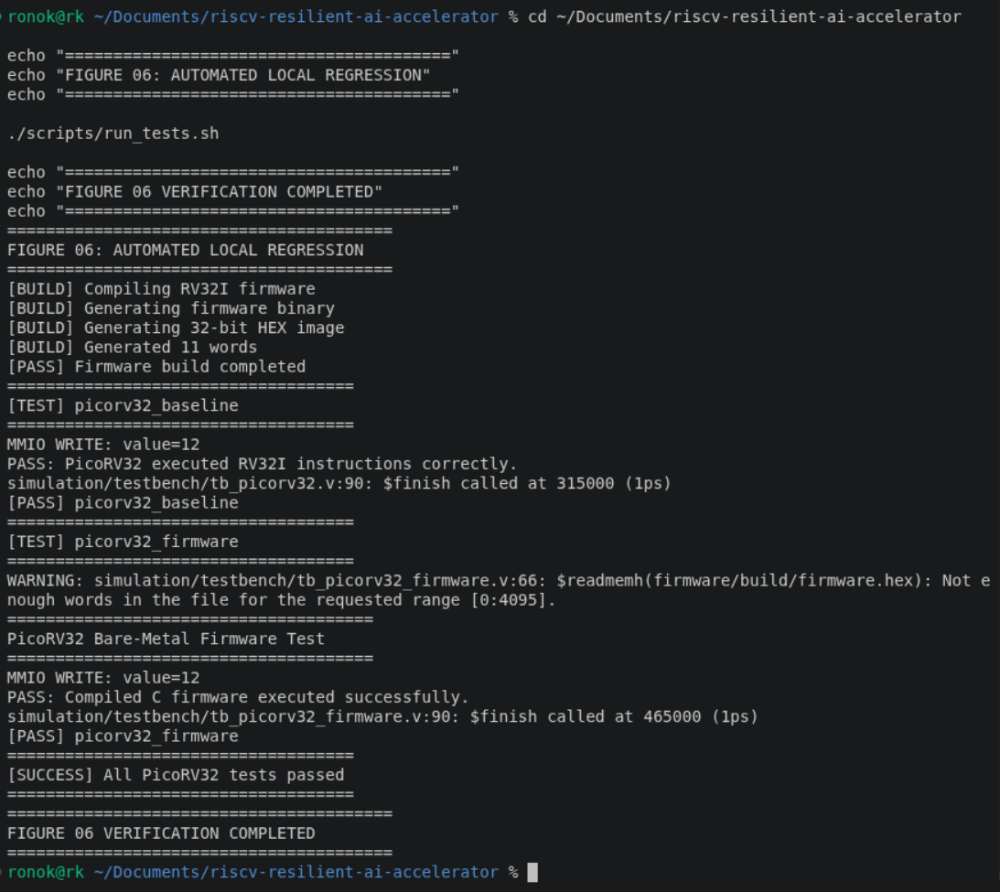
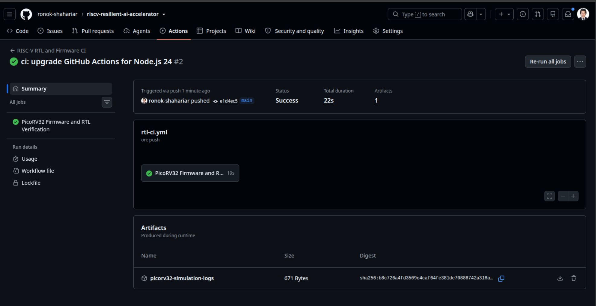
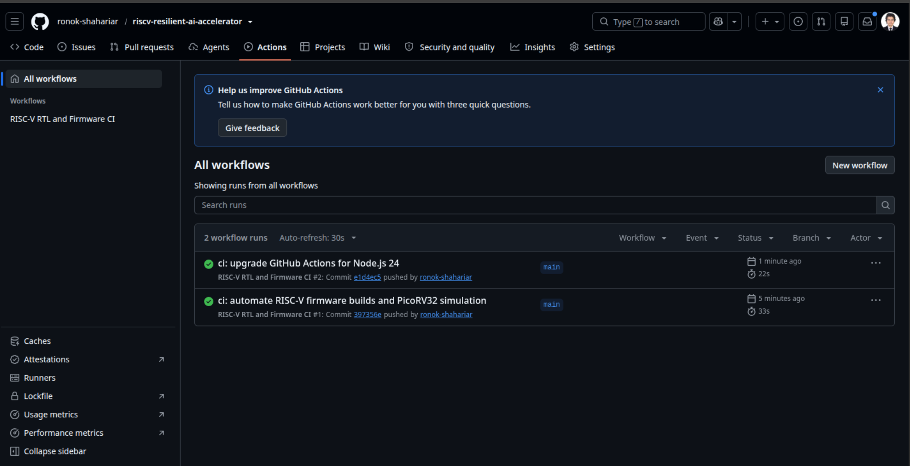

# RISC-V-Based Fault-Resilient INT8 AI Accelerator

**Week 01 — Engineering Report | 19 October 2026**

Engineering progress report • Reporting date: 19 October 2026 • Project phase: verified simulation baseline
Repository: https://github.com/ronok-shahariar/riscv-resilient-ai-accelerator
Hardware target: ALINX AX7203 (Artix-7 XC7A200T family); exact FPGA package/speed grade not yet confirmed.
Document purpose: preserve evidence, commands, design decisions, limitations and next actions for reproducibility, academic review and later portfolio publication.
# Executive summary

During Week 01, the PicoRV32 RV32I core was integrated into a local research repository, verified in an instruction-level Verilog testbench, and used to execute a GCC-built bare-metal C program through a simulated 16 KB memory and MMIO interface. The codebase was published to GitHub and an automated GitHub Actions verification pipeline succeeded twice, including the upgraded Node.js 24-compatible workflow. This is a simulation and CI achievement—not yet a programmed AX7203 board or an implemented neural-network accelerator.
| Milestone | Evidence | State |
|---|---|---|
| PicoRV32 RTL baseline | Simulation wrote 12 to 0x10000000 | PASS |
| C firmware execution | ELF32 → HEX → PicoRV32 MMIO=12 | PASS |
| Build and regression scripts | Both local simulations pass | PASS |
| Remote GitHub Actions | Run #2, e1d4ec5, 22 s, 1 artifact | PASS |
| AX7203 timing/bitstream | Not performed | PENDING |
| Fault-resilient INT8 datapath | Not implemented | PENDING |

# 1. Scope and success criteria

- Verify the local Linux/FPGA/RISC-V toolchain and Vivado availability.
- Import PicoRV32 as a version-recorded upstream source; preserve its license.
- Prove RV32I instruction execution and a memory-mapped write with a self-checking Verilog testbench.
- Compile bare-metal C for RV32I, convert firmware to a Verilog-readable image and execute it on PicoRV32.
- Establish Git history, publish source and enable automated CI that builds and tests on an independent runner.

Out of scope this week: INT8 MAC, quantization, fault injection, resilience metrics, model inference accuracy, DSP inference, implementation timing, actual FPGA programming and measurement.
# 2. Development platform

| Item | Observed / planned configuration |
|---|---|
| Operating system | Ubuntu 24.04.5 LTS (Noble), x86_64 |
| FPGA tools | Vivado 2025.2, invoked through settings64.sh |
| HDL simulator | Icarus Verilog 12.0; vvp |
| Cross compiler | riscv64-unknown-elf-gcc 13.2.0, with -march=rv32i -mabi=ilp32 |
| Binutils | binutils-riscv64-unknown-elf 2.42 |
| Version control | Git 2.43.0, main branch |
| Development board | ALINX AX7203; XC7A200T family device recognized by Vivado |
| PicoRV32 revision | ef203c2b0a3fb793280f5114941416c425c5b461 |

Vivado executable verified at /home/ronok/Vivado2025.2/2025.2/Vivado/bin/vivado. get_parts returned XC7A200T variants including fbg484, fbg676 and ffg1156; supported family does NOT establish the exact board package. Verify the chip marking/board schematic before pin assignments or hardware implementation.



*Figure 01. Vivado 2025.2 and XC7A200T device support.*




*Figure 02. RISC-V compiler and RV32I verification.*


# 3. Repository layout and provenance

```bash
riscv-resilient-ai-accelerator/
├── .github/workflows/rtl-ci.yml
├── firmware/{src/main.c,src/start.S,linker/picorv32.ld,build/}
├── rtl/cpu/{picorv32.v,PICORV32_LICENSE,UPSTREAM_COMMIT}
├── simulation/testbench/{tb_picorv32.v,tb_picorv32_firmware.v}
├── scripts/{build_firmware.sh,run_tests.sh}
├── constraints/   docs/   results/   verification/
└── README.md / .gitignore
```

PicoRV32 originated from https://github.com/YosysHQ/picorv32. Its original source was copied into rtl/cpu along with its upstream license and exact upstream commit identifier. Generated firmware/build and simulation/build outputs are ignored; source, build scripts and testbenches are versioned. Git does not track initially empty directories.
| Commit | Purpose |
|---|---|
| d1b1fd3 | Initialize project structure, README and ignore rules |
| 8ab7bd5 | Import PicoRV32 and verify manual RV32I MMIO program |
| e4018fd | Build and execute bare-metal C firmware in simulation |
| 397356e | Automate firmware builds and PicoRV32 tests with GitHub Actions |
| e1d4ec5 | Update checkout to v5 and upload-artifact to v7 |




*Figure 03. Repository structure and Git history.*


# 4. CPU baseline: manually encoded instructions

The initial simulation testbench instantiated the picorv32 top module with reset address 0x0 and compressed ISA disabled, plus a lightweight request/response memory model. Five RV32I instructions computed 5 + 7 and wrote the result to memory-mapped address 0x10000000.
| Instruction / address | Behavior |
|---|---|
| addi x1, x0, 5 | x1 = 5 |
| addi x2, x1, 7 | x2 = 12 |
| lui x3, 0x10000 | x3 = 0x10000000 |
| sw x2, 0(x3) | MMIO store data = 12 |
| jal x0, 0 | Terminal loop |

```bash
iverilog -g2012 -s tb_picorv32 -o /tmp/tb_picorv32.vvp   rtl/cpu/picorv32.v simulation/testbench/tb_picorv32.v
vvp /tmp/tb_picorv32.vvp
```

Observed: “MMIO WRITE: value=12” and “PASS: PicoRV32 executed RV32I instructions correctly.” The testbench called $finish at 315000 in 1 ps simulation precision (315 ns); this is functional simulation time and must not be presented as real FPGA latency.
Debugging note: an initial testbench used the incorrect parameter ENABLE_COMPRESSED. Replacing it with the actual PicoRV32 parameter COMPRESSED_ISA fixed elaboration. Keep this as a reproducibility lesson.



*Figure 04. PicoRV32 baseline simulation.*


# 5. C firmware, startup and linker integration

A small bare-metal C application writes 12 to 0x10000000 using a volatile uint32_t pointer. Startup assembly initializes the stack at the 16 KB RAM ceiling and calls main; the linker script places text/data/bss at RAM origin 0x0, sets entry _start, and defines the stack top. The C computation was constant-folded by -O2, so this verifies firmware execution and MMIO access, NOT software arithmetic performance.
```bash
riscv64-unknown-elf-gcc -march=rv32i -mabi=ilp32 -O2   -ffreestanding -fno-builtin -fno-pic -msmall-data-limit=0   -mno-relax -nostdlib -nostartfiles -Wl,--no-relax   -Wl,--build-id=none -T firmware/linker/picorv32.ld   firmware/src/start.S firmware/src/main.c   -o firmware/build/firmware.elf
```

| ELF observation | Value |
|---|---|
| Class / machine | ELF32 / RISC-V |
| Entry point | 0x00000000 |
| text / data / bss | 44 / 0 / 0 bytes |
| MMIO output store | sw a4, 0(a5), with a5 = 0x10000000 and a4 = 12 |

The ELF was converted to a flat binary with riscv64-unknown-elf-objcopy -O binary and then to 11 little-endian 32-bit hex words. The image begins 00004117, 00010113, 00000097, 00c080e7. The firmware testbench used $readmemh to load the image into simulated 4096-word RAM.
```bash
./scripts/build_firmware.sh
./scripts/run_tests.sh
```

Observed firmware test: MMIO WRITE: value=12; PASS: Compiled C firmware executed successfully. Testbench $finish occurred at 465000 ps (465 ns). The “Not enough words” $readmemh warning stems from reading 11 image words into a 4096-word array preinitialized to NOPs. For future cleanliness, set an explicit readmemh end index or load a padded image.



*Figure 05. Bare-metal C firmware and ELF verification.*




*Figure 06. Automated local regression verification.*


# 6. Continuous integration design

The GitHub Actions workflow lives at .github/workflows/rtl-ci.yml. It runs on pushes to main, pull requests targeting main and manual dispatch. The job uses ubuntu-24.04, a 15-minute timeout and read-only contents permission. It checks out source, installs Icarus Verilog and RISC-V GCC/binutils, runs the local verification script and publishes simulation logs even after failed tests (where available).
| Stage | Implementation / verification |
|---|---|
| Checkout | actions/checkout@v5 |
| Tool setup | apt install iverilog, gcc-riscv64-unknown-elf, binutils-riscv64-unknown-elf, python3 |
| Firmware build | scripts/build_firmware.sh; compiled ELF, BIN and HEX |
| Tests | scripts/run_tests.sh: baseline and C firmware testbenches |
| Logs | actions/upload-artifact@v7; artifact picorv32-simulation-logs |

The shell test runner uses set -euo pipefail and checks expected PASS strings; a failed compiler, simulation or missing PASS causes CI to fail. It is currently a minimal deterministic smoke-test suite, not exhaustive CPU verification. The uploaded logs are CI evidence; generated binaries are intentionally not committed.
# 7. GitHub Actions evidence — supplied screenshots

The screenshots below were provided after the workflow update and show the second run of “RISC-V RTL and Firmware CI”, commit e1d4ec5, status Success, total duration 22 seconds, one successful job and one produced artifact. The run summary has no warning annotation visible in the supplied image.


*Figure 1. Successful GitHub Actions run #2: commit e1d4ec5, 22 seconds, one artifact (user-provided capture).*



*Figure 2. GitHub Actions history: both run #1 and run #2 succeeded (user-provided capture).*

The screenshots verify CI job success, not FPGA board execution. Do not claim synthesis success or achieved device frequency based on GitHub Actions simulation alone.
# 8. Problems encountered and fixes

| Issue | Diagnosis | Resolution |
|---|---|---|
| vivado not found | Vivado installed outside PATH | Source ~/Vivado2025.2/2025.2/Vivado/settings64.sh; add to Zsh startup |
| No output from process-substitution Tcl | Vivado did not execute expected Tcl content | Create standalone /tmp/check_ax7203.tcl and use -source |
| ENABLE_COMPRESSED elaboration error | Incorrect PicoRV32 parameter name | Use COMPRESSED_ISA(0) |
| Zsh else dquote> prompt | Incomplete pasted multiline quote/conditional | Ctrl+C, inspect files, create source using Python heredoc |
| $readmemh` not enough words | 11 words loaded into 4096-word RAM | Safe for preinitialized RAM; improve load bounds later |
| GitHub Node.js 20 warning | Older action versions | Upgrade checkout v4→v5 and upload-artifact v4→v7 |

# 9. Limitations and honest interpretation

- No FPGA synthesis, placement, routing, bitstream or hardware-in-the-loop test has been run.
- Vivado XC7A200T availability does not identify the exact AX7203 FPGA package or speed grade.
- The 100 MHz testbench clock is a simulated source; no actual FPGA timing closure or frequency claim is justified.
- No integer MAC, INT8 model, fault injector or clamp/resilience scheme is in the project yet.
- The C sample uses compile-time constants; no meaningful CPU-versus-accelerator speedup is measurable yet.
- The behavioral testbench memory is not yet a validated FPGA-inferred block RAM implementation.
- The software test presently checks one known MMIO value rather than a broad range of ISA/memory corner cases.

# 10. Evidence capture checklist and placement plan

| Figure | Capture to retain | Recommended repository path |
|---|---|---|
| 01 | Vivado version and supported Artix-7 parts | docs/screenshots/week01/01-vivado-device-support.png |
| 02 | ELF32 / RV32I compiler disassembly | docs/screenshots/week01/02-rv32i-toolchain.png |
| 03 | Repo tree and Git commit history | docs/screenshots/week01/03-repository-history.png |
| 04 | Baseline PICORV32 simulation PASS | docs/screenshots/week01/04-baseline-test.png |
| 05 | C firmware ELF and output size | docs/screenshots/week01/05-elf-disassembly.png |
| 06 | Local regression 2/2 PASS | docs/screenshots/week01/06-local-regression.png |
| 07 | GitHub run #2 summary (included) | docs/screenshots/week01/07-ci-run-success.png |
| 08 | GitHub CI run history (included) | docs/screenshots/week01/08-ci-run-history.png |

Screenshot practice: retain legible terminal commands and results; crop unrelated desktop details; avoid usernames/secrets if sharing externally; add a date and commit ID to captions; never doctor or reconstruct evidence. Figures 07 and 08 are already embedded in this report. Other figure slots are deliberately marked for later capture rather than fabricated.
# 11. Reproduce the Week 1 verification

```bash
git clone https://github.com/ronok-shahariar/riscv-resilient-ai-accelerator.git
cd riscv-resilient-ai-accelerator
sudo apt-get update
sudo apt-get install -y iverilog gcc-riscv64-unknown-elf   binutils-riscv64-unknown-elf python3
./scripts/run_tests.sh
```

Expected local completion: [PASS] picorv32_baseline; [PASS] picorv32_firmware; [SUCCESS] All PicoRV32 tests passed. Source revision to reproduce this documented CI state: e1d4ec5. A clean cloned repository requires the build script to regenerate ignored firmware/build assets.
# 12. Next-week implementation plan and test requirements

- Implement a standalone synthesizable signed INT8 × INT8 multiplier and INT32 accumulator with explicit reset, valid, clear and result timing.
- Write self-checking tests for signed extremes (-128, -1, 0, +1, +127), repeated MAC sequences, reset behavior, valid/ready timing, and accumulator wraparound policy.
- Add MAC regression to scripts/run_tests.sh, then verify GitHub CI on a new commit.
- Design and document a stable MMIO register map and precise CPU/peripheral handshake prior to integration.
- Keep fault injection and any clamp/mitigation strategy separated until baseline arithmetic is correct.
- Verify AX7203 exact part and clock/pin constraints before actual Vivado implementation.

Recommended later metrics: software-only dot-product cycles vs accelerator including MMIO overhead, hardware resource utilization (LUT/FF/DSP/BRAM), timing slack and Fmax, model-level accuracy with a labeled dataset, and fault-recovery effectiveness with fixed seeds and well-defined injection sites.
# 13. Weekly-report operating procedure

At the end of each week, freeze a known Git commit, run local regression and remote CI, collect precise measured outputs, label failures and fixes, archive screenshot evidence, document major architecture changes, and clearly separate completed work from planned work. Use the template below every week.
| Section | Information to record |
|---|---|
| Week and dates | Start/end, objectives, commit range, repository link |
| Architecture delta | New modules, register map and signal timing |
| Implementation | Files changed, commands/tool versions, rationales |
| Verification | Test cases, expected vs observed, CI URL and result |
| Evidence | Numbered figures/screenshots, raw logs, reports |
| Problems | Reproduction, root cause, fix, regression |
| Measurements | Units, exact tool/board configuration, conditions |
| Open risks / next steps | Unverified assumptions and next-week milestones |

Final Week 01 assessment: software-to-simulated-hardware bring-up and CI are complete. FPGA implementation and resilience research remain future work. This distinction protects scientific credibility and makes later performance claims auditable.

---

### Figure 07 — GitHub Actions successful CI run


*Figure 07. GitHub Actions successful CI run.*

### Figure 08 — GitHub Actions run history


*Figure 08. GitHub Actions run history.*
