# Week 02 — RISC-V-Controlled INT8 MAC Accelerator: RTL, MMIO, Firmware, and Verification

**Project:** RISC-V-Based Fault-Resilient INT8 AI Accelerator
**Target platform:** ALINX AX7203 (Artix-7); FPGA deployment not yet performed
**Development platform:** Ubuntu 24.04; Icarus Verilog; RISC-V GNU cross-toolchain
**Period:** Week 02 · October 2026
**Repository:** [riscv-resilient-ai-accelerator](https://github.com/ronok-shahariar/riscv-resilient-ai-accelerator)
**Verified integration commit:** [`d775da0`](https://github.com/ronok-shahariar/riscv-resilient-ai-accelerator/commit/d775da0)
**CI:** GitHub Actions, *RISC-V RTL and Firmware CI*, successful run **#8** (22 s shown in screenshot)

> **Evidence boundary:** Results in this report are from RTL simulation, bare-metal cross-compilation, and GitHub Actions CI. They are **not** FPGA hardware measurements, post-synthesis timing results, or demonstrations of fault tolerance. Fault injection and protective mechanisms remain future work.

## 1. Executive summary

Week 02 extended the Week 01 PicoRV32 firmware baseline with a custom **signed INT8 multiply–accumulate (MAC)** unit featuring a **signed INT32 accumulator**, a memory-mapped register peripheral, and a bare-metal C application that drives the peripheral through PicoRV32's native memory interface. The implementation was verified progressively: standalone arithmetic checks, every possible INT8 operand pair, MMIO transactions, and a processor-controlled end-to-end simulation.

The full local regression completed **six passing test suites**. It included **213 directed/randomized MAC checks**, **65,536 signed operand-pair tests**, and **16 standalone MMIO checks**. The integrated firmware issued three MAC commands, checked intermediate results, and reported a final accumulator of **39**. GitHub Actions CI passed on commit `d775da0`.

## 2. Objectives and scope

- Implement a deterministic signed 8-bit multiplication and 32-bit accumulation datapath.
- Exercise signed arithmetic, clear/reset precedence, enable handling, and INT32 wraparound.
- Verify the complete 256 × 256 signed INT8 operand space.
- Expose the MAC as an MMIO peripheral compatible with a PicoRV32-style valid/ready bus.
- Build independent RV32I accelerator firmware without replacing Week 01 firmware.
- Demonstrate PicoRV32 executing firmware that accesses the accelerator and validates its results.
- Add the new tests to the existing GitHub Actions regression pipeline.

**Out of scope this week:** FPGA programming, board-specific constraints, post-route frequency, DSP/resource utilization, power, model-level inference benchmarks, radiation/fault injection, error detection/recovery, and reliability metrics.

## 3. System architecture

```text
                   +--------------------------+
                   | PicoRV32 (RV32I CPU)     |
                   | Firmware: ELF32 / RV32I  |
                   +------------+-------------+
                                |
                      mem_valid / mem_ready
                     addr / wdata / wstrb / rdata
                                |
                   +------------v-------------+
                   | Simulation SoC bus route |
                   +------+----------+--------+
                          |          |        |
               0x00000000|          |        |0x10000000
                   16 KiB |          |        |Test-report output
                          v          |        v
                   +----------+     |    +--------------+
                   | RAM      |     |    | SIM-only     |
                   | firmware |     |    | pass/fail    |
                   +----------+     |    +--------------+
                                    |0x80000000
                                    v
                         +----------------------+
                         | INT8 MAC MMIO        |
                         | operand / control /  |
                         | status / result      |
                         +----------+-----------+
                                    |
                         +----------v-----------+
                         | Signed INT8 MAC      |
                         | INT32 accumulator    |
                         +----------------------+
```

The bus routing, RAM, and test-report termination in `tb_picorv32_accelerator.v` are **testbench constructs**. A reusable synthesizable SoC interconnect and hardware memory subsystem have **not** yet been established.

### 3.1 Arithmetic datapath

The MAC computes a signed 8 × 8-bit product, sign-extends that product to 32 bits, and adds it to the accumulator when enabled:

\[
\mathrm{acc}_{n+1} = \mathrm{wrap}_{32}(\mathrm{acc}_{n} + \mathrm{signed8}(a) \times \mathrm{signed8}(w)).
\]

`resetn` and `clear` reset the accumulator to zero; `clear` takes priority over `mac_en`. `result_valid` indicates a MAC operation for a single cycle. The architecture as implemented does **not** include saturation or fault protection.

**RTL:** `rtl/accelerator/int8_mac.v`
**Standalone arithmetic tests:** `simulation/testbench/tb_int8_mac.v`, `simulation/testbench/tb_int8_mac_exhaustive.v`

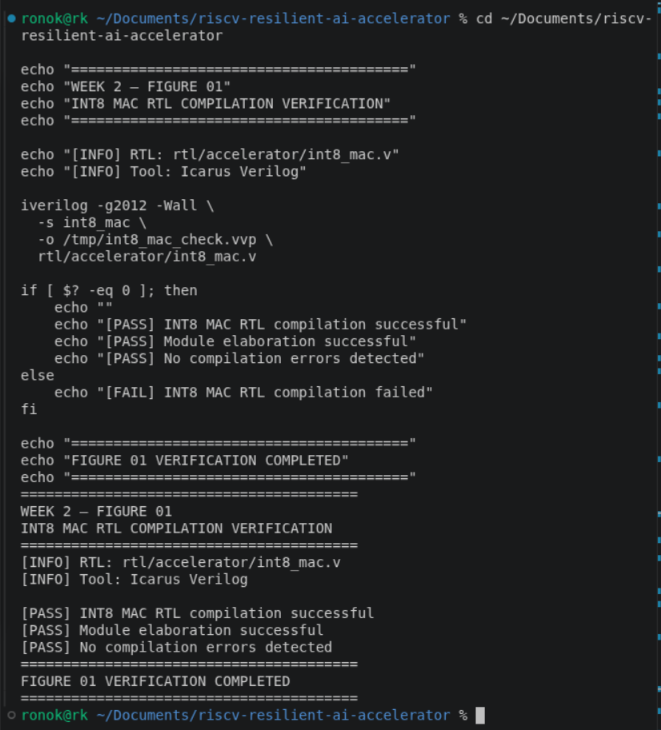

*Figure 01. Successful compilation/elaboration of the signed INT8 MAC module; compilation alone does not establish functional correctness.*

## 4. Verification of the signed INT8 MAC

### 4.1 Directed, boundary, random, and overflow tests

The self-checking directed testbench covered positive/negative products, zero, idle operation, clearing, simultaneous clear/enable priority, signed INT8 boundaries, randomized input pairs, and INT32 overflow wraparound. Following a testbench timing correction described in §8, it finished with **213 passing checks**.

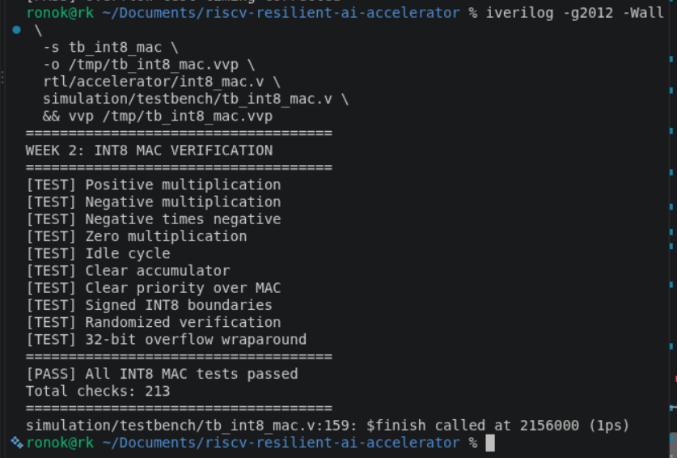

*Figure 02. Directed, randomized, boundary, and wraparound tests passing after the testbench correction (213 checks).*

### 4.2 Exhaustive signed operand-pair tests

The exhaustive testbench iterated `activation` and `weight` from **−128 through +127**, covering **256 × 256 = 65,536** pairs. Each product was compared indirectly through a reference-model accumulated INT32 result. All pair checks passed.

This covers the **full signed INT8 operand-pair space**, not every possible accumulator starting state, reset timing, bus sequence, or wider system behavior.

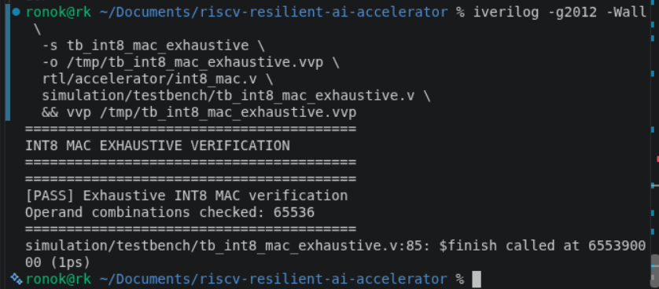

*Figure 03. All 65,536 signed INT8 operand combinations passed standalone MAC verification.*

### 4.3 Combined component regression

Following the Week 01 CPU and firmware baselines, the first combined run added the MAC tests without altering the verified PicoRV32 test programs.

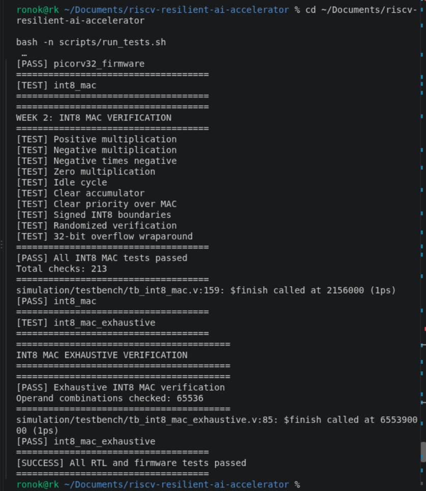

*Figure 04. Local regression evidence after standalone MAC test integration.*

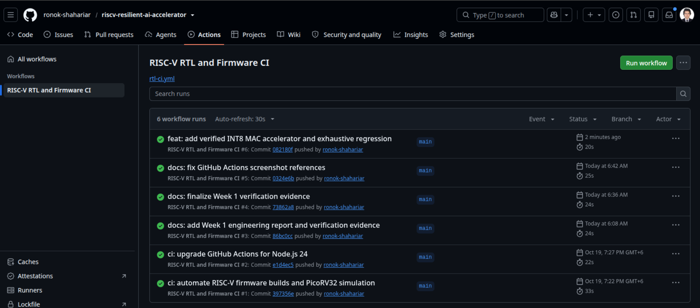

*Figure 05. GitHub Actions success for the committed INT8 MAC arithmetic regression.*

## 5. Memory-mapped accelerator interface

**RTL:** `rtl/accelerator/int8_mac_mmio.v`
**Base address:** `0x80000000` (32-byte decoded region)

| Absolute address | Offset | Register | Access | Semantics |
|---|---:|---|---|---|
| `0x80000000` | `0x00` | ACTIVATION | W | Signed activation, low 8 bits |
| `0x80000004` | `0x04` | WEIGHT | W | Signed weight, low 8 bits |
| `0x80000008` | `0x08` | CONTROL | W | Bit 0: START; bit 1: CLEAR; CLEAR takes priority |
| `0x8000000C` | `0x0C` | STATUS | R | Bit 0: sticky DONE |
| `0x80000010` | `0x10` | RESULT | R | Signed INT32 accumulated result |
| `0x80000014` | `0x14` | FAULT_CONFIG | Reserved | Not implemented; reads zero / writes ignored |
| `0x80000018` | `0x18` | PROTECTION | Reserved | Not implemented; reads zero / writes ignored |

Full-word writes use `mem_wstrb == 4'b1111`; reads use `mem_wstrb == 0`. In the current implementation, partial writes, unsupported writes, and misaligned accesses are acknowledged but have no functional register effect; unsupported reads return zero. This is the **implemented test-interface policy**, not a complete system-level access-fault architecture.

The controller registers START and CLEAR pulses. The arithmetic unit consumes those signals synchronously; `result_valid` is subsequently captured as a sticky DONE status. Firmware polls DONE before reading RESULT. `request_armed` prevents acceptance of a continuously asserted request more than once and re-arms on a low `mem_valid` cycle.

**Integration caution:** The handshake behavior was exercised by standalone tests and by the particular PicoRV32 firmware sequence, but general support for all back-to-back bus sequences has not been proven. The controller should be re-reviewed when turning the simulation interconnect into synthesizable system RTL.

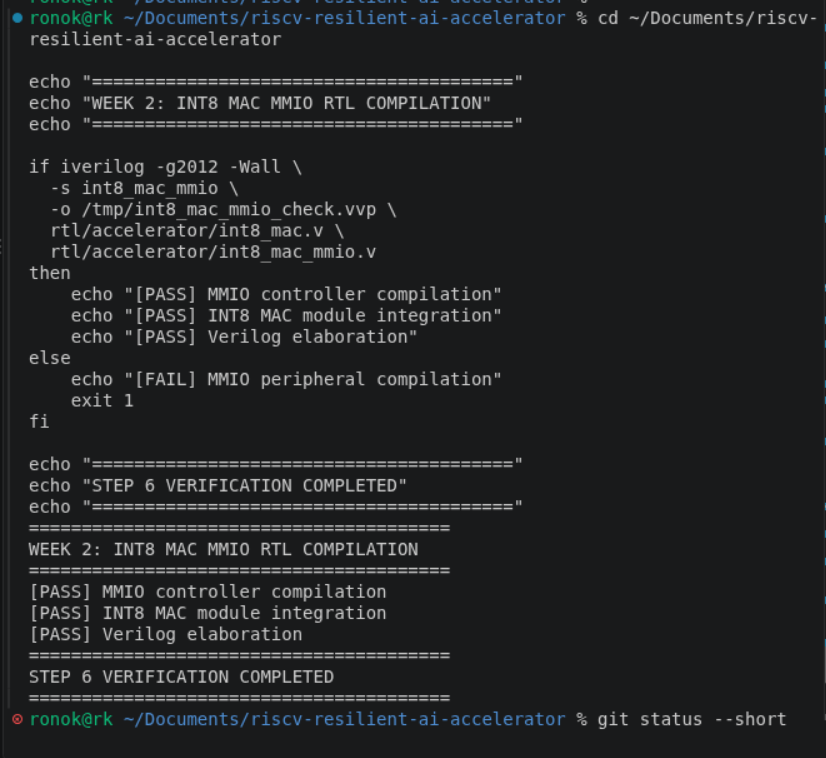

*Figure 06. Compiling the MMIO wrapper together with the existing MAC RTL.*

### 5.1 Standalone MMIO verification

The MMIO testbench covered reset state, signed operands, cumulative arithmetic, sticky DONE, clearing, ignored partial writes, reserved-register reads, and a held-`mem_valid` transaction. It reported **16 successful checks**.

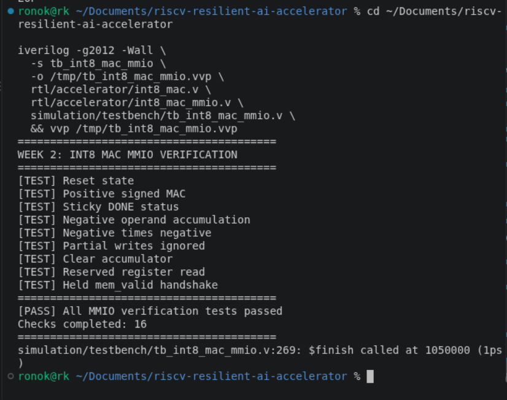

*Figure 07. Standalone MMIO simulation passing all 16 checks.*

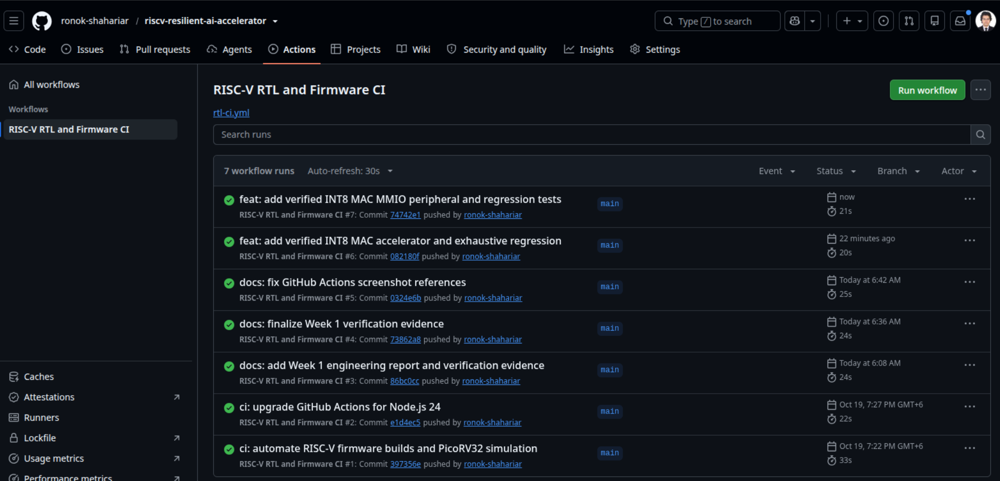

*Figure 08. GitHub Actions workflow #7 passed on MMIO integration commit `74742e1`.*

## 6. RV32I firmware and processor-controlled execution

**Firmware:** `firmware/accelerator/main.c`
**Build script:** `scripts/build_accelerator_firmware.sh`
**Integrated testbench:** `simulation/testbench/tb_picorv32_accelerator.v`

The separate accelerator build reuses `firmware/src/start.S` and `firmware/linker/picorv32.ld`, but writes its own image to `firmware/accelerator/build/`. The Week 01 `firmware/src/main.c` and its existing build path remain unchanged.

| Firmware artifact property | Observed |
|---|---:|
| ELF class / machine | ELF32 / RISC-V |
| Reset entry point | `0x0` |
| Reported `.text` | 340 bytes |
| Reported `.data` / `.bss` | 0 / 0 bytes |
| Binary image size | 340 bytes |
| HEX image length | 85 32-bit words |
| Simulated RAM capacity | 16 KiB |

Firmware clears the accumulator, issues three START commands, polls STATUS, checks intermediate RESULT values, and reports success through a simulation MMIO address at `0x10000000`.

| Step | Calculation | Expected accumulated result |
|---|---|---:|
| 1 | `5 × 7` | 35 |
| 2 | `35 + (−3 × 4)` | 23 |
| 3 | `23 + (−8 × −2)` | **39** |

The integrated simulation observed **exactly three START commands** and a firmware success report of **39**; it also checked that the accelerator accumulator was 39 at termination. The reported simulation finish time was **3,155 ns**, measured in the testbench's simulated 100 MHz clock environment, **not** an FPGA frequency or board-level execution-time measurement.

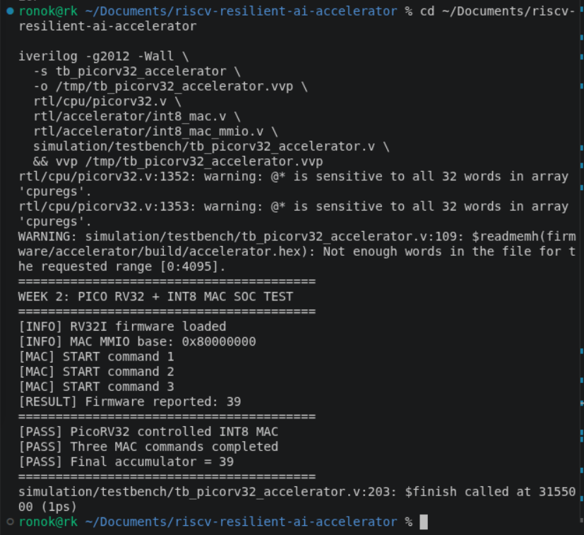

*Figure 09. PicoRV32 executing accelerator firmware and successfully reporting the final accumulator value 39.*

## 7. Regression automation and CI reproducibility

`scripts/run_tests.sh` now builds the original firmware, executes the original CPU and firmware checks, runs the MAC arithmetic tests, runs the MMIO checks, builds independent accelerator firmware, and runs the integrated SoC simulation. GitHub Actions installs Icarus Verilog, the RISC-V GNU toolchain, and Python on Ubuntu 24.04; the existing workflow invokes the regression script and uploads `simulation/build/*.log` artifacts.

### 7.1 Results table

| Suite | Verification target | Observed outcome |
|---|---|---|
| `picorv32_baseline` | CPU RV32I baseline | PASS |
| `picorv32_firmware` | Legacy bare-metal firmware | PASS |
| `int8_mac` | Directed, random, boundary, overflow | PASS — 213 checks |
| `int8_mac_exhaustive` | All signed INT8 operand pairs | PASS — 65,536 pairs |
| `int8_mac_mmio` | Standalone register/bus interface | PASS — 16 checks |
| `picorv32_accelerator` | CPU + MMIO + accelerator + firmware | PASS — 3 MAC commands; result 39 |

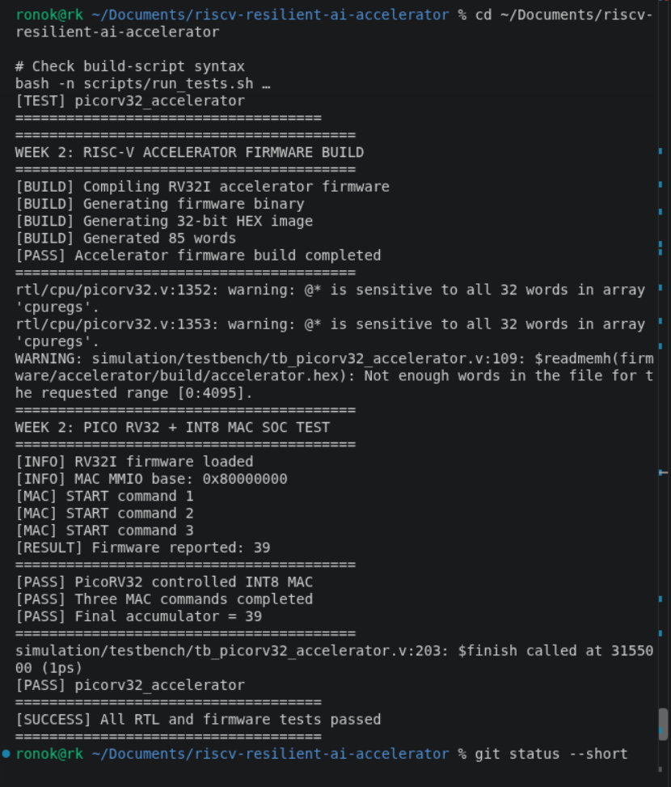

*Figure 10. All six local RTL and firmware regression suites passing.*

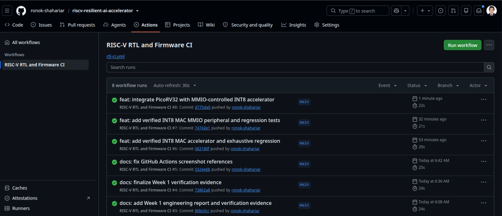

*Figure 11. GitHub Actions workflow #8 passing after commit `d775da0` (22 seconds shown in the workflow history).*

### 7.2 Reproduction commands

Run from the repository root:

```bash
bash -n scripts/run_tests.sh
bash -n scripts/build_accelerator_firmware.sh
./scripts/run_tests.sh
```

To run only the integrated SoC test, first build the firmware:

```bash
./scripts/build_accelerator_firmware.sh
iverilog -g2012 -Wall \
  -s tb_picorv32_accelerator \
  -o /tmp/tb_picorv32_accelerator.vvp \
  rtl/cpu/picorv32.v \
  rtl/accelerator/int8_mac.v \
  rtl/accelerator/int8_mac_mmio.v \
  simulation/testbench/tb_picorv32_accelerator.v
vvp /tmp/tb_picorv32_accelerator.vvp
```

### 7.3 Known nonfatal simulation warnings

- Icarus Verilog `-Wall` may report PicoRV32 `@*` sensitivity warnings for the `cpuregs` array. These originate from the CPU RTL and did not fail the observed simulation.
- `$readmemh` reports that the 11-word legacy firmware or 85-word accelerator firmware is shorter than the specified 4,096-word RAM array. In the testbenches, RAM is initialized before loading the HEX image, so the remainder is defined; the warning does not mean the firmware failed to load.

These should be reported accurately; the integrated build is not warning-free. Future cleanup can constrain the `$readmemh` load range to the actual firmware length.

## 8. Debugging case study — overflow-test stimulus timing

The first directed verification run failed at **Test 212**, in the intended INT32 overflow-wraparound test:

```text
[FAIL] Test 212
Expected ACC=-2147467535, VALID=1
Actual   ACC=-2147462960, VALID=1
FATAL: MAC verification failed
```

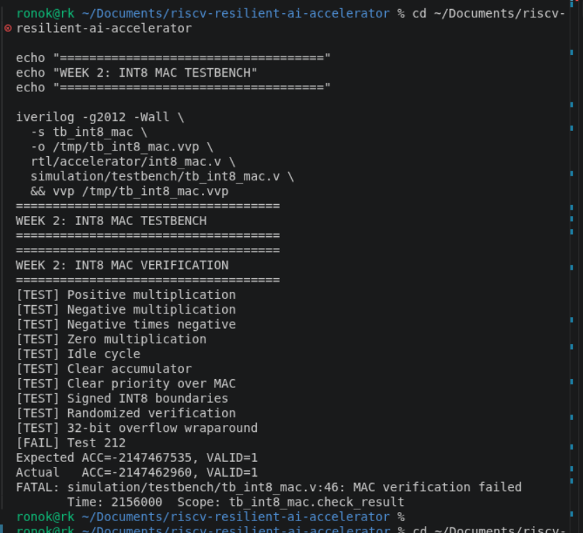

*Figure 02A. Preserved failure output before debugging the testbench timing.*

**Diagnosis:** The testbench placed a known value in the DUT's accumulator on a falling clock edge and then invoked `run_cycle`, which waited until a **subsequent** falling edge to apply the overflow stimulus. Because `mac_en` was still asserted from the preceding randomized operation, the intervening rising edge caused an extra MAC accumulation of **4,575**. The expected and actual values differed by exactly 4,575.

**Correction:** Deassert `mac_en` while preparing the accumulator, before calling `run_cycle`:

```verilog
@(negedge clk);
mac_en = 0;
dut.acc_result = 32'h7ffffff0;
expected_acc = 32'h7ffffff0;
run_cycle(127, 127, 1, 0);
```

**Retest:** All **213 checks passed**, including the wraparound case. **No arithmetic RTL change was required**. The failure was caused by stimulus timing, not evidence of an arithmetic defect.

**Lesson learned:** Self-checking testbenches must account for active clock edges during setup. Direct hierarchical register initialization is useful for targeted scenarios but should be complemented by protocol-driven tests when strengthening verification.

## 9. Engineering limitations and next actions

1. **FPGA implementation:** No Vivado synthesis, place-and-route, timing closure, DSP48E1 usage, bitstream generation, or AX7203 board test is claimed. Confirm the board's exact FPGA part/package/speed grade before selecting hardware constraints.
2. **SoC synthesis readiness:** The integrated memory/router/test-output logic currently resides in the **simulation testbench**. Extract a synthesizable SoC top, RAM interface, and address decoder before hardware implementation.
3. **Bus protocol robustness:** Test held requests, repeated accesses, and PicoRV32's actual behavior more broadly; ensure the MMIO peripheral and future interconnect handle successive transactions unambiguously.
4. **Verification coverage:** Exhaustive *operand-pair* testing is not exhaustive over INT32 accumulator states, reset transitions, or all bus interleavings. Expand assertions and directed cases.
5. **Fault resilience:** No injected faults, detection logic, mitigation, or fault-coverage statistics exist yet. Week 03 should define fault models, injection points, golden references, and recovery criteria before reporting resilience.
6. **Build hygiene:** Retain generated ELF/BIN/HEX and `.vvp` files as build products, not source evidence. Commit source code, scripts, the Markdown report, and the actual screenshot evidence.

## 10. Week 02 completion statement

**Completed and verified in simulation:** custom signed INT8 × INT8 → INT32 MAC, arithmetic and operand-space testing, MMIO wrapper, independent RV32I firmware, PicoRV32-controlled MAC execution, six-suite local regression, and successful GitHub Actions execution for the integrated commit.

**Pending:** reusable synthesizable SoC integration, FPGA implementation, and the fault-injection/resilience design and experiments planned for Week 03.

---

### Appendix — Screenshot manifest

All image links in this report are relative to `docs/weekly-reports/` and refer to files under `screenshots/week02/`.

| File | Content |
|---|---|
| `01-int8-mac-rtl-compilation.png` | Arithmetic RTL compilation |
| `02-int8-mac-directed-tests_fault.png` | Preserved overflow-test failure |
| `02-int8-mac-directed-tests.png` | Corrected 213-check test |
| `03-int8-mac-exhaustive-tests.png` | 65,536 operand-pair test |
| `04-combined-regression.png` | Initial combined regression |
| `05-github-ci-success.png` | Arithmetic MAC CI evidence |
| `06-int8-mac-mmio-compilation.png` | MMIO RTL compilation |
| `07-int8-mac-mmio-verification.png` | MMIO 16-check verification |
| `08-mmio-github-ci-success.png` | MMIO CI evidence |
| `09-picorv32-mac-integration.png` | End-to-end SoC simulation |
| `10-six-suite-regression.png` | Final local six-suite regression |
| `11-soc-github-ci-success.png` | Integrated SoC CI evidence |
